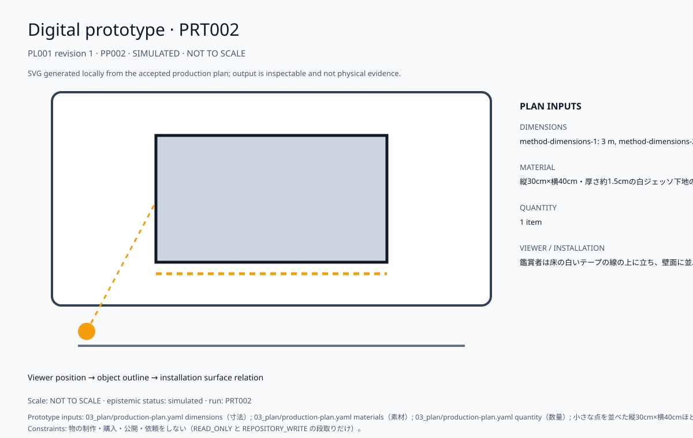

# 統合制作計画書

> この文書は、受理済みhandoffと検証済みの制作計画を、人間が読んで制作判断・制作実務に使える一つの計画書へ統合したものです。計画の生成は、購入・契約・公開・連絡・削除・物理作業の実行承認を意味しません。

### 計画メタデータ

| 項目 | 内容 |
| --- | --- |
| プロジェクト | production/auto-catalog-20261027-e-b050f4b1747b |
| 計画 | PL001 revision 1 |
| 計画状態 | PLANNING |
| 計画準備 | 開始可能 |
| 物理・外部制作 | 承認待ち |
| 開始できる最初の作業 | `TK004`, `TK006` |
| 後続の承認・外部確認 | PG010 |
| 出力を止める構造上の不足 | なし |
| 生成日時 | 2026-10-27T12:54:59.776700+00:00 |
| handoff | HO001 revision 1 |
| 要件カバレッジ | 100% |
| クリティカルパス | `TK001` → `TK002` → `TK003` |

## 1. 完成像

| 項目 | 内容 |
| --- | --- |
| experience sequence / encounter | 展覧会場の入口で、床の白いテープの線に立った鑑賞者が、壁に並ぶ小さな色の点が目の中でふっと混ざり、光が増して見える瞬間に足を止める。, 展示室の奥で、壁の隅に置かれた小さな試し塗りの色見本パネルの前に鑑賞者がしゃがみ込み、顔を近づけたり離したりしながら、点が混ざって見える距離を何度も探っている。, 出口近くの休憩用ベンチに腰を下ろした鑑賞者が、遠くの大きな一枚を眺めながら、点が混ざる箇所と混ざりきらず揺らぐ箇所の違いを指でなぞるように見分けている。 |
| position | 鑑賞者は床の白いテープの線の上に立ち、壁面に並ぶ小さな色の点をまっすぐ見つめる姿勢で、作品と一定の距離を保っている。 |
| first_seconds | 床の白いテープの位置に立つと、壁に並んだ小さな色の点が目の中で混ざり合って光が輝いて見える一方、その混ざり方がどこか曖昧であることにも気づく。 |
| after_30s | 床の白いテープの位置に立つと、並んだ小さな色の点が目の中で混ざって光り輝く一方、その混ざり方がどこか曖昧なことに気づき、しばらくじっと見つめて確かめる。 |
| after_3min | 色の点が目の中で光りながらも曖昧に混ざる感覚が残り、その曖昧さを消さずに、安定した部分から費用を固め残りは予備枠で受け止めればよいと考えている。 |

## 2. テーマ

| 項目 | 内容 |
| --- | --- |
| field | 点描(新印象派)の視覚芸術・絵画の分野 |
| stands_against | 曖昧さをすべて解消してから費用を一括で確定しようとする考え方や、不確かさを見積もりに含めず隠してしまう慣習に対抗する。 |
| difference | 印象派が混色させず細かいタッチで置く感覚的で曖昧な方法だったのに対し、この案は小さな試し塗りで点の混ざり方を確かめ、安定した部分から費用を確定し曖昧な箇所だけ予備枠を置く点が異なる。 |
| why_now | 2026-10-27 時点の公開資料の調査で、この案の元になった洞察（IN003）が得られた: これらの主張は弱い根拠に基づくため断定はできないが、分割した点を観る人の目の中で混ぜる手法は光の効果を高める一方で感覚的な曖昧さも残すので、費用確定の判断をどこまで前倒しできるかは、この主張だけでは決められない。 |

## 3. メッセージ

| 項目 | 内容 |
| --- | --- |
| claim | 曖昧さを抱えたままでも、小さな試し塗りで見え方が安定した部分から順に費用を確定し、残る不確かな箇所だけを予備枠で受け止めれば、制作の費用は段階的に固められる。 |
| who_disagrees | 固定価格契約を重視する発注担当の経理部長は、不確かさを残した段階的な費用確定ではなく、最初に総額を確定すべきだと反対する。 |
| denies | この作品は、曖昧さが残るうちは費用を決められず、すべてを一度に確定しなければならないという考えを否定する。 |
| shown_not_told | 床の白いテープの位置に立つと、並んだ小さな色の点が目の中で混ざって光り輝き、その混ざり方の曖昧さまで感じられることを見せている。 |

## 4. コンセプト

| 項目 | 内容 |
| --- | --- |
| mechanism | 鑑賞者は床の白いテープの線に立ち、壁の試し塗りキャンバスに並んだ小さな色の点が目の中で混ざり合う様子を見つめ、光の輝きと混ざり方の曖昧さを体感し、緑と赤で印した費用シートで安定箇所と予備枠の関係を理解する。 |
| without_the_technique | CEASES_TO_WORK |
| precedents | reference=スーラと新印象派―輝ける点描の画家たち― ｜展覧会情報検索 アートコモンズ｜国立新美術館 THE NATIONAL ART CENTER, TOKYO <https://www.nact.jp/artcommons/user/detail/4241>, difference=先行作品の印象派は「混色させずに」細かいタッチで置く感覚的で曖昧なものだったのに対し、採用案は「小さな試し塗り」で点の混ざり方を確かめ、曖昧さの残る箇所だけ予備枠を置くという確認重視の進め方である。 |
| self_repetition_risk | reference=creator history not supplied (Stage B --history-root), assessment=UNKNOWN: Creator history was not supplied; repetition is unmeasured. |

## 5. 調査の要約

| 項目 | 内容 |
| --- | --- |
| questions | 言語化できない段階でも、新印象派の分割して置く手法と具体性への移行は費用確定の手がかりになるか？, 新印象派の分割して置く手法は、制作に耐える具体性を保ちつつ、費用確定の判断をどこまで前倒しできるのか？, 言語化できていない段階で、新印象派の分割と具体表現への移行を、費用確定に先立つ制作の検証手順にするなら何から試すべきか？, 制作に耐えるか確かめる試作で、分割して置いた要素のどれが具体性の高い表現へ移れば、費用確定の根拠にできるのか？, 言語化前の段階で、費用確定を先送りせず、新印象派の分割配置を使い、どの要素から具体化して見積もれば制作に耐えると言えるのか？, 試作で「分割して置く」要素を一つ選び具体的な表現に移したとき、その手応えを費用確定の判断材料にできるか？, 言語化が難しい段階で、費用が膨らむ箇所を先に見積もるには、分割した要素のうち何を具体的な表現で確かめればよいのか？, 新印象派の点描のように、まず制作に耐える小さな単位へ分け、その一つを具体表現で試作すれば、費用確定の根拠になるか？ |
| what_was_read | 取得資料 47 件（内容が重複しない資料 44 件）から、根拠 25 件・抜き書き 38 件を取った。主な資料: 「Divisionism - Wikipedia」、「Neo-Impressionism - Wikipedia」、「Neo-impressionism \| Tate」、「Neo-Impressionism — Musée Giverny」、「ゴッホ、スーラ、モンドリアン…色彩分割の流れを俯瞰する企画展 \| ニュース \| アイエム［インターネットミュージアム］」。 |
| what_came_out | 主張 33 件、洞察 17 件、判断 17 件。IN001: スーラの分割技法や展覧会の前売券期間は、いずれも根拠が弱く、費用確定の直接的な手がかりになるとは断定できず、せいぜい補助的な参考情報にとどまる可能性がある。 IN002: この抜き書きは分割主義が新印象主義の方法論の中心にあることを示すにとどまり、費用確定の手がかりになるかは、この資料だけでは断定できない。 IN003: これらの主張は弱い根拠に基づくため断定はできないが、分割した点を観る人の目の中で混ぜる手法は光の効果を高める一方で感覚的な曖昧さも残すので、費用確定の判断をどこまで前倒しできるかは、この主張だけでは決められない。 |
| what_is_not_settled | 未解決の問い 1 件（Q001）。対立したままの主張の組 1 件。調査の下限に届かない項目: evidence 25/30、self_repetition_review。試作と鑑賞者による確認は未実施（調査の不確実性 17 件が OPEN）。 |

### 採択内容と根拠

| 項目 | 内容 |
| --- | --- |
| 採択仮説 | PH002 |
| 仮説タイトル | 点描に学ぶ試し塗りと予備枠の費用 |
| 仮説 | 小さな試し塗りで見え方が安定した部分から順に費用を確定し、曖昧さが残る箇所だけ予備枠で受け止めることで、不確かさを抱えたまま制作の費用を段階的に固められる。 |
| 仮説状態 | PROPOSED |
| 選択状態 | PROVISIONAL |
| 選択権限 | AGENT |
| 人間承認要否 | いいえ |
| 選択理由 | 小さな試し塗りで見え方が安定した部分から順に費用を確定し、曖昧さが残る箇所だけ予備枠で受け止めることで、不確かさを抱えたまま制作の費用を段階的に固められる。 |
| 創作指針 | 05_production/creative-direction.md |

### 制作リファレンス

コンセプト、ビジュアル、制作手法の参照先です。URLは受理済みhandoffに含まれる恒久HTTPS URLだけを掲載し、アクセスできない参照や不足カテゴリはギャップとして残します。

| 分類 | 出所ID | 種別 | 概要 | アクセスURL | 状態 | URL理由コード |
| --- | --- | --- | --- | --- | --- | --- |
| その他 | DC001 | decision | DC001-option-1 selected under IN001: スーラの分割技法や展覧会の前売券期間は、いずれも根拠が弱く、費用確定の直接的な手がかりになるとは断定できず、せいぜい補助的な参考情報にとどまる可能性がある。 | URL未提供（gap参照） | MISSING | INTERNAL_RECORD |
| その他 | DC003 | decision | DC003-option-1 selected under IN003: これらの主張は弱い根拠に基づくため断定はできないが、分割した点を観る人の目の中で混ぜる手法は光の効果を高める一方で感覚的な曖昧さも残すので、費用確定の判断をどこまで前倒しできるかは、この主張だけでは決められない。 | URL未提供（gap参照） | MISSING | INTERNAL_RECORD |
| その他 | IN001 | insight | スーラの分割技法や展覧会の前売券期間は、いずれも根拠が弱く、費用確定の直接的な手がかりになるとは断定できず、せいぜい補助的な参考情報にとどまる可能性がある。 | URL未提供（gap参照） | MISSING | INTERNAL_RECORD |
| その他 | IN003 | insight | これらの主張は弱い根拠に基づくため断定はできないが、分割した点を観る人の目の中で混ぜる手法は光の効果を高める一方で感覚的な曖昧さも残すので、費用確定の判断をどこまで前倒しできるかは、この主張だけでは決められない。 | URL未提供（gap参照） | MISSING | INTERNAL_RECORD |
| その他 | EV001 | evidence | agent-retrieved-public; rights_status=unknown; sensitivity=PUBLIC_CITABLE | <https://www.nact.jp/english/artcommons/user/detail/4241> | AVAILABLE | — |
| その他 | EV002 | evidence | agent-retrieved-public; rights_status=unknown; sensitivity=PUBLIC_CITABLE | <https://www.nact.jp/artcommons/user/detail/43862> | AVAILABLE | — |
| その他 | EV004 | evidence | agent-retrieved-public; rights_status=unknown; sensitivity=PUBLIC_CITABLE | <https://www.nact.jp/artcommons/user/detail/4241> | AVAILABLE | — |
| コンセプト | EV009 | evidence | agent-retrieved-public; rights_status=unknown; sensitivity=PUBLIC_CITABLE | <https://www.tate.org.uk/art/art-terms/n/neo-impressionism> | AVAILABLE | — |
| 手法 | EV009 | evidence | agent-retrieved-public; rights_status=unknown; sensitivity=PUBLIC_CITABLE | <https://www.tate.org.uk/art/art-terms/n/neo-impressionism> | AVAILABLE | — |
| ビジュアル | EV025 | evidence | agent-retrieved-public; rights_status=unknown; sensitivity=PUBLIC_CITABLE | <https://www.museum.or.jp/report/580> | AVAILABLE | — |

### 要件と受入の目的

| 要件 | 優先度 | 要件内容 | 出所 | 受入テスト | 計画上の対応 |
| --- | --- | --- | --- | --- | --- |
| RQ001 | mandatory | 鑑賞者が床の白いテープの位置に立つと、並んだ小さな色の点が目の中で混ざって光り輝きつつ曖昧さも残り、3分後もその曖昧さを消さずに、安定した部分から費用を固め残りは予備枠で受け止めると考えている。 | 未設定 | AT001 | COVERED |
| RQ002 | mandatory | 縦30cm×横40cmほどの点描の試し塗り板、緑と赤で安定と曖昧を印し確定費用と予備枠を併記したA3費用シート、床の白テープ線から点の混ざり方を確かめる壁面展示が揃っていること。 | 未設定 | AT002 | COVERED |
| RQ003 | mandatory | 鑑賞者が床の白いテープの線の上に立って壁の小さな色の点を見つめると、点が目の中で混ざり合って見え、その安定した部分から順に費用が確定し、曖昧さの残る箇所だけが予備枠として示される。 | 未設定 | AT003 | COVERED |
| RQ004 | mandatory | 鑑賞者が床のテープの線に立ってキャンバスの色の点が目の中で混ざる様子を見つめ、輝きと混ざり方の曖昧さを体感したうえで、緑と赤の費用シートから安定箇所と予備枠の関係を言葉にして説明できること。 | 未設定 | AT004 | COVERED |

## 6. できている物

### ビジュアルパッケージ

boardとmockupは、受理済みhandoffから生成した閲覧用の決定論的fixtureです。外部画像素材の取得・採用、物理制作、外部検証、公開、購入、契約、Drive共有は実施していません。

| 種別 | 名称 | 状態 | 相対リンク | asset hash | 権利 | 安全 |
| --- | --- | --- | --- | --- | --- | --- |
| ビジュアルリファレンスボード | Visual reference board · 小さな試し塗りで見え方が安定した部分から順に費用を確定し、曖昧さが残る箇所だけ予備枠で受け止めることで、不確かさを抱えたまま制作の費用を段階的に固められる。 | BOARD | [03_plan/media/visual-reference-board.svg](media/visual-reference-board.svg) | sha256:6c47c6a7933198880899ef2f610bf991b75144e85bd3598e18a94580b276debc | PROJECT_INTERNAL | CLEAR |
| コンセプト・モックアップ | Concept mockup · 小さな試し塗りで見え方が安定した部分から順に費用を確定し、曖昧さが残る箇所だけ予備枠で受け止めることで、不確かさを抱えたまま制作の費用を段階的に固められる。 | MOCKUP | [03_plan/media/concept-mockup.svg](media/concept-mockup.svg) | sha256:f3ac0d183104fdbadb591bee57297f36428790b721014c3931974d016d1b3bec | PROJECT_INTERNAL | REVIEW_REQUIRED |

| mockup注記 | 内容 |
| --- | --- |
| 表現種別 | CONCEPTUAL |
| 寸法 | Not to scale; physical dimensions are not supplied by the accepted handoff. |
| 素材 | Material selection remains provisional and is not a purchase or fabrication instruction. |
| 配置 | 鑑賞者は床の白いテープの線の上に立ち、壁面に並ぶ小さな色の点をまっすぐ見つめる姿勢で、作品と一定の距離を保っている。 |
| 検証 | PHYSICAL_EXTERNAL validation: NOT_RUN. No physical prototype, publication, purchase, contract, or Drive share was performed. |

まだ何も作っていない。この節は、制作した物が実行台帳（`05_execution/output-versions.yaml`）に記録された時点で、現物とプレビュー画像を載せる。

## 6A. 試作（デジタル、simulated）

ここに示すのは受理済みplanから生成した決定論的なデジタルpreviewです。実物、物理試作、鑑賞者検証、公開承認の証拠ではありません。

### PRT002 / PP002

| 項目 | 内容 |
| --- | --- |
| run ID | PRT002 |
| plan revision | 1 |
| 寸法 | method-dimensions-1: 3 m, method-dimensions-2: 4 m, method-dimensions-3: 30 cm |
| 素材 | 縦30cm×横40cm・厚さ約1.5cmの白ジェッソ下地の綿布張り木製キャンバスパネル |
| 状態 | simulated / 実物ではない / NOT TO SCALE |
| 出力 | 03_plan/media/prototype/PRT002-1.svg |

## 7. 制作範囲と成果物

| 項目 | 内容 |
| --- | --- |
| スコープ状態 | PROVISIONAL |
| 必須要件ID | RQ001, RQ002, RQ003, RQ004 |
| 試作計画ID | PP001, PP002 |
| 前提 | なし |
| 除外・未許可範囲 | publish, submit, send, purchase, contract, delete |
| 権利制約 | なし |
| 安全制約 | なし |
| プライバシー制約 | なし |
| 再計画トリガー | new_evidence, material_change, rights_or_privacy_change |

| 成果物 | 種別 | 内容 | 受入テスト | 担当能力 | 納期 | 状態 |
| --- | --- | --- | --- | --- | --- | --- |
| DL001 | production-deliverable | 点描に学ぶ試し塗りと予備枠の費用 | AT001, AT002, AT003, AT004 | production-agent（PHYSICAL_EXTERNAL・PUBLICATION・PURCHASE の段取りは人の承認後に実行） | MS004 | PLANNED |

## 8. 技術仕様・材料・資源

| 仕様 | 対象 | 目標 | 許容差 | 測定方法 | 出所要件 | 状態 |
| --- | --- | --- | --- | --- | --- | --- |
| TS001 | experience-RQ001 | kind=QUALITATIVE, statement=鑑賞者が床の白いテープの位置に立つと、並んだ小さな色の点が目の中で混ざって光り輝きつつ曖昧さも残り、3分後もその曖昧さを消さずに、安定した部分から費用を固め残りは予備枠で受け止めると考えている。 | 未設定 | viewer_session | RQ001 | PROVISIONAL |
| TS002 | material-RQ002 | kind=QUALITATIVE, statement=縦30cm×横40cmほどの点描の試し塗り板、緑と赤で安定と曖昧を印し確定費用と予備枠を併記したA3費用シート、床の白テープ線から点の混ざり方を確かめる壁面展示が揃っていること。 | 未設定 | prototype_review | RQ002 | PROVISIONAL |
| TS003 | interaction-RQ003 | kind=QUALITATIVE, statement=鑑賞者が床の白いテープの線の上に立って壁の小さな色の点を見つめると、点が目の中で混ざり合って見え、その安定した部分から順に費用が確定し、曖昧さの残る箇所だけが予備枠として示される。 | 未設定 | viewer_session | RQ003 | PROVISIONAL |
| TS004 | mechanism-RQ004 | kind=QUALITATIVE, statement=鑑賞者が床のテープの線に立ってキャンバスの色の点が目の中で混ざる様子を見つめ、輝きと混ざり方の曖昧さを体感したうえで、緑と赤の費用シートから安定箇所と予備枠の関係を言葉にして説明できること。 | 未設定 | viewer_session | RQ004 | PROVISIONAL |
| TS005 | method-dimensions-1 | kind=QUANTITY, statement=展示空間は約3m×4m、試し塗りキャンバスは縦30cm×横40cm、費用管理シートはA3（297mm×420mm）とする。, quantity=value=3, unit=m | 未設定 | 完成した作品または試作で作品全体と主な構成要素の寸法（数値と単位）を確かめ、提案値「展示空間は約3m×4m、試し塗りキャンバスは縦30cm×横40cm、費用管理シートはA3（297mm×420mm）とする。」と一致するかを記録する。 | なし | PROVISIONAL |
| TS006 | method-dimensions-2 | kind=QUANTITY, statement=展示空間は約3m×4m、試し塗りキャンバスは縦30cm×横40cm、費用管理シートはA3（297mm×420mm）とする。, quantity=value=4, unit=m | 未設定 | 完成した作品または試作で作品全体と主な構成要素の寸法（数値と単位）を確かめ、提案値「展示空間は約3m×4m、試し塗りキャンバスは縦30cm×横40cm、費用管理シートはA3（297mm×420mm）とする。」と一致するかを記録する。 | なし | PROVISIONAL |
| TS007 | method-dimensions-3 | kind=QUANTITY, statement=展示空間は約3m×4m、試し塗りキャンバスは縦30cm×横40cm、費用管理シートはA3（297mm×420mm）とする。, quantity=value=30, unit=cm | 未設定 | 完成した作品または試作で作品全体と主な構成要素の寸法（数値と単位）を確かめ、提案値「展示空間は約3m×4m、試し塗りキャンバスは縦30cm×横40cm、費用管理シートはA3（297mm×420mm）とする。」と一致するかを記録する。 | なし | PROVISIONAL |
| TS008 | method-materials | kind=QUALITATIVE, statement=試し塗りキャンバスは厚さ約1.5cmの綿布張りの木製パネルに白色ジェッソ下地を塗りマット仕上げとし、費用シートはA3の上質紙（90kg・マット）を用いる。 | 未設定 | 完成した作品または試作で主な素材（種類・厚み・仕上げなど具体名）を確かめ、提案値「試し塗りキャンバスは厚さ約1.5cmの綿布張りの木製パネルに白色ジェッソ下地を塗りマット仕上げとし、費用シートはA3の上質紙（90kg・マット）を用いる。」と一致するかを記録する。 | なし | PROVISIONAL |
| TS009 | method-assembly | kind=QUALITATIVE, statement=白ジェッソ下地の綿布張り木製パネル（厚さ1.5cm）を壁にフック2点で掛け、A3費用シートは四隅をマスキングテープで壁に貼り、立ち位置の白テープ線は床に幅2cmで直線に貼ってつなぐ。 | 未設定 | 完成した作品または試作で組み立て方（部材をどうつなぐか）を確かめ、提案値「白ジェッソ下地の綿布張り木製パネル（厚さ1.5cm）を壁にフック2点で掛け、A3費用シートは四隅をマスキングテープで壁に貼り、立ち位置の白テープ線は床に幅2cmで直線に貼ってつなぐ。」と一致するかを記録する。 | なし | PROVISIONAL |
| TS010 | method-installation | kind=QUALITATIVE, statement=厚さ1.5cmの白ジェッソ下地の綿布張り木製パネルを壁にフック2点で掛け、A3費用シートは四隅をマスキングテープで壁に貼り、床の立ち位置は幅2cmの白テープを直線に貼ってつなぐ。 | 未設定 | 完成した作品または試作で設置の方法（どこに・どう固定・配置するか）を確かめ、提案値「厚さ1.5cmの白ジェッソ下地の綿布張り木製パネルを壁にフック2点で掛け、A3費用シートは四隅をマスキングテープで壁に貼り、床の立ち位置は幅2cmの白テープを直線に貼ってつなぐ。」と一致するかを記録する。 | なし | PROVISIONAL |

| 材料 | 仕様 | 数量 | 権利 | 安全 | 出所試作 | 状態 |
| --- | --- | --- | --- | --- | --- | --- |
| MT001 | 縦30cm×横40cm・厚さ約1.5cmの白ジェッソ下地の綿布張り木製キャンバスパネル — 試し塗りキャンバスは厚さ約1.5cmの綿布張りの木製パネルに白色ジェッソ下地を塗りマット仕上げとし、費用シートはA3の上質紙（90kg・マット）を用いる。 | value=1, unit=item | REVIEW_REQUIRED | REVIEW_REQUIRED | PP001, PP002 | CANDIDATE |

| 資源 | 種別 | 必要能力 | 数量 | 可用性 | 関連タスク |
| --- | --- | --- | --- | --- | --- |
| RS001 | EQUIPMENT | 丸筆（ラウンド筆）の4号 | value=1, unit=set | REQUIRES_CONFIRMATION | TK001 |

## 9. 工程と作業手順

| 作業パッケージ | 内容 | 投入物 | 制約 | 成果物 | タスク | 担当能力 | 状態 |
| --- | --- | --- | --- | --- | --- | --- | --- |
| WP001 | 床のテープ位置に複数人を立たせて壁の試し塗りキャンバスを見てもらい、安定と判断した箇所を緑、曖昧な箇所を赤で記録して人ごとの判定の一致度を比べ、費用シートで曖昧箇所の塗り直し費用を合計して予備枠の金額が足りるか照らし合わせる。 | 小さな点を並べた縦30cm×横40cmほどの試し塗り用キャンバス板。点の混ざり方を確かめる見本として使う。, 試し塗りの安定箇所を緑、曖昧な箇所を赤で印し、確定済みの費用と予備枠の金額を並べて書いた、A3一枚の費用管理シート。, 鑑賞者が立つ位置を示す、床に貼った白いテープの線と、その位置から点の混ざり方を確かめるための壁面展示スペース。 | なし | DL001 | TK001, TK002, TK003 | production-agent（PHYSICAL_EXTERNAL・PUBLICATION・PURCHASE の段取りは人の承認後に実行） | BLOCKED |
| WP002 | 制作プランの寸法・素材・数量を読み、構成要素の配置を SVG の図に描いて、制作要件と照らす。 | 03_plan/production-plan.yaml dimensions（寸法）, 03_plan/production-plan.yaml materials（素材）, 03_plan/production-plan.yaml quantity（数量）, 小さな点を並べた縦30cm×横40cmほどの試し塗り用キャンバス板。点の混ざり方を確かめる見本として使う。, 試し塗りの安定箇所を緑、曖昧な箇所を赤で印し、確定済みの費用と予備枠の金額を並べて書いた、A3一枚の費用管理シート。, 鑑賞者が立つ位置を示す、床に貼った白いテープの線と、その位置から点の混ざり方を確かめるための壁面展示スペース。 | 物の制作・購入・公開・依頼をしない（READ_ONLY と REPOSITORY_WRITE の段取りだけ）。 | DL001 | TK004, TK005, TK006 | digital-prototype-renderer | PLANNED |

| タスク | 作業 | 前提 | 所要時間 | 必要材料 | 受入条件 | 効果種別 | 承認 | 状態 |
| --- | --- | --- | --- | --- | --- | --- | --- | --- |
| TK001 | 縦30cm×横40cmほどのキャンバス板に小さな点を並べて試し塗りをし、点の混ざり方が安定する箇所と曖昧な箇所を見分ける。 | なし | value=40, unit=h | WP001の投入物 | 縦30cm×横40cmのキャンバス板に点を並べた試し塗りが完成し、点がきれいに混ざって見える箇所と曖昧な箇所がそれぞれ区別して示されている。 | PHYSICAL_EXTERNAL | AR001 | BLOCKED |
| TK002 | 安定と判定した箇所の費用を確定して費用管理シートに記入し、曖昧な箇所には予備枠の金額を割り当てる。 | TK001 | value=40, unit=h | WP001の投入物 | 費用管理シートの安定と判定した全ての箇所に確定額が記入され、曖昧な箇所すべてに予備枠の金額が割り当てられている。 | REPOSITORY_WRITE | なし | BACKLOG |
| TK003 | 床に貼った白いテープの線の位置に立ち、壁面に並べた試し塗りの点の混ざり方を確かめ、その見え方で安定と曖昧の判定を見直す。 | TK002 | value=40, unit=h | WP001の投入物 | 白いテープの線の位置から試し塗りの点の混ざり方を見て、安定と曖昧の判定を見直した結果が記録されている。 | READ_ONLY | なし | BACKLOG |
| TK004 | 制作プランの寸法・素材・数量を読み、描く構成要素を並べる。 | なし | value=1, unit=h | WP002の投入物 | 構成要素ごとに寸法・素材・数量が一覧になっている。 | READ_ONLY | なし | READY |
| TK005 | 構成要素の配置を SVG の図に描いて試作の出力として保存する。 | TK004 | value=1, unit=h | WP002の投入物 | SVG の図が保存され、すべての構成要素が寸法の比率どおりに描かれている。 | REPOSITORY_WRITE | なし | BACKLOG |
| TK006 | Validate derived plan coverage | なし | value=15, unit=min | WP002の投入物 | The derived plan graph and mandatory requirement coverage are valid. | READ_ONLY | なし | READY |

**実施順の読み方:** クリティカルパスは `TK001` → `TK002` → `TK003` です。開始可能な最初の作業は `TK004`, `TK006` です。物理・外部効果を伴う後続タスクは承認待ちであり、承認 register と外部確認が整うまで実行されません。

## 10. 試作・受入評価

| テスト | 対象要件 | 方法 | 合格条件 | 現在結果 |
| --- | --- | --- | --- | --- |
| AT001 | RQ001 | viewer_session | 鑑賞者が床の白いテープ位置に立ち、色の点が目の中で混ざって輝きつつ曖昧さも残る状態が3分後も保たれ、費用が安定部分で固定され残りが予備枠で吸収されていれば合格とする。 | NOT_RUN |
| AT002 | RQ002 | prototype_review | 縦30cm×横40cm程度の点描試し塗り板、緑と赤で安定と曖昧を印し確定費用と予備枠を併記したA3費用シート、床の白テープ線から点の混ざり方を確認できる壁面展示の三点が、すべて実物として揃っていれば合格とする。 | NOT_RUN |
| AT003 | RQ003 | viewer_session | 床の白いテープの線上に立って壁の色点を見ると点が混ざって見え、その安定部分から順に費用が確定し、曖昧な箇所だけが予備枠として示されていれば合格とする。 | NOT_RUN |
| AT004 | RQ004 | viewer_session | 鑑賞者が床のテープの線に立って色の点が混ざる様子を見て輝きと曖昧さを体感し、緑と赤の費用シートから安定箇所と予備枠の関係を自分の言葉で正しく説明できていれば合格とする。 | NOT_RUN |

| マイルストーン | 内容 | 順序 | 前提 | 状態 |
| --- | --- | --- | --- | --- |
| MS001 | Start 床のテープ位置に複数人を立たせて壁の試し塗りキャンバスを見てもらい、安定と判断した箇所を緑、曖昧な箇所を赤で記録して人ごとの判定の一致度を比べ、費用シートで曖昧箇所の塗り直し費用を合計して予備枠の金額が足りるか照らし合わせる。 | 1 | なし | PLANNED |
| MS002 | Complete 床のテープ位置に複数人を立たせて壁の試し塗りキャンバスを見てもらい、安定と判断した箇所を緑、曖昧な箇所を赤で記録して人ごとの判定の一致度を比べ、費用シートで曖昧箇所の塗り直し費用を合計して予備枠の金額が足りるか照らし合わせる。 | 2 | MS001 | BLOCKED |
| MS003 | Start 制作プランの寸法・素材・数量を読み、構成要素の配置を SVG の図に描いて、制作要件と照らす。 | 3 | MS002 | PLANNED |
| MS004 | Complete 制作プランの寸法・素材・数量を読み、構成要素の配置を SVG の図に描いて、制作要件と照らす。 | 4 | MS003 | PLANNED |

## 11. 日程と予算

| 日程・予算項目 | 内容 |
| --- | --- |
| 日程モード | RELATIVE |
| 日程基準線 | PROVISIONAL |
| タスク日程 | task_id=TK001, duration=value=40, unit=h, start_at=未設定, due_at=未設定, task_id=TK002, duration=value=40, unit=h, start_at=未設定, due_at=未設定, task_id=TK003, duration=value=40, unit=h, start_at=未設定, due_at=未設定, task_id=TK004, duration=value=1, unit=h, start_at=未設定, due_at=未設定, task_id=TK005, duration=value=1, unit=h, start_at=未設定, due_at=未設定, task_id=TK006, duration=value=15, unit=min, start_at=未設定, due_at=未設定 |
| 日程ギャップ | Calendar dates and availability are not supplied by the accepted handoff; the schedule remains relative. |
| 通貨 | JPY |
| 予算総額 | amount=20000, currency=JPY |
| 予備費 | amount=2000, currency=JPY |
| 承認閾値 | amount=22000, currency=JPY |
| 予算状態 | ESTIMATED |
| 予算ギャップ | Planning amounts are fixed per-band assumptions from cost-estimation.yaml v1; they are not estimates, quotes, or observed market prices. |

| 予算項目 | 区分 | 内容 | 金額 | 根拠 | 確度 | 状態 |
| --- | --- | --- | --- | --- | --- | --- |
| BI001 | prototype-plan | Estimated cost band for PP001 | amount=10000, currency=JPY | Prototype PP001, cost band LOW, assumed amount 10000 JPY; materials: 縦30cm×横40cm・厚さ約1.5cmの白ジェッソ下地の綿布張り木製キャンバスパネル (試し塗りキャンバスは厚さ約1.5cmの綿布張りの木製パネルに白色ジェッソ下地を塗りマット仕上げとし、費用シートはA3の上質紙（90kg・マット）を用いる。; quantity 1 item). The band amount is a fixed per-band planning allowance; material quantity and dimensions are not reflected in the amount. cost-estimation.yaml v1; These are planning assumptions for rough estimates, not observed market prices, quotes, or supplier commitments. | LOW | ESTIMATED |
| BI002 | prototype-plan | Estimated cost band for PP002 | amount=10000, currency=JPY | Prototype PP002, cost band LOW, assumed amount 10000 JPY; materials: 縦30cm×横40cm・厚さ約1.5cmの白ジェッソ下地の綿布張り木製キャンバスパネル (試し塗りキャンバスは厚さ約1.5cmの綿布張りの木製パネルに白色ジェッソ下地を塗りマット仕上げとし、費用シートはA3の上質紙（90kg・マット）を用いる。; quantity 1 item). The band amount is a fixed per-band planning allowance; material quantity and dimensions are not reflected in the amount. cost-estimation.yaml v1; These are planning assumptions for rough estimates, not observed market prices, quotes, or supplier commitments. | LOW | ESTIMATED |

## 12. リスクと未解決事項

| リスク | 内容 | 影響 | 軽減策 | 重要度 | 可能性 | 担当 | 状態 |
| --- | --- | --- | --- | --- | --- | --- | --- |
| RK001 | 小さな試し塗りで見え方が安定したと判断できる基準が、実際に床のテープ位置から点の混ざり方を見たときに鑑賞者間で揃うのか、また予備枠がどの程度の額で足りるのかは、試作して確かめないと分からない。 | 小さな試し塗りで見え方が安定したと判断できる基準が、実際に床のテープ位置から点の混ざり方を見たときに鑑賞者間で揃うのか、また予備枠がどの程度の額で足りるのかは、試作して確かめないと分からない。 | Validate the uncertainty before relying on the affected plan decision. | MAJOR | UNKNOWN | production-agent（PHYSICAL_EXTERNAL・PUBLICATION・PURCHASE の段取りは人の承認後に実行） | OPEN |
| RK002 | Handoff gap GP001 | evidence count 25 is below the minimum 30. | Resolve the handoff gap and regenerate the plan before relying on the affected decision. | MEDIUM | UNKNOWN | production-agent（PHYSICAL_EXTERNAL・PUBLICATION・PURCHASE の段取りは人の承認後に実行） | OPEN |
| RK003 | Handoff gap GP002 | At least one record is required in 04_decisions/self-repetition-review.yaml. | Resolve the handoff gap and regenerate the plan before relying on the affected decision. | MEDIUM | UNKNOWN | production-agent（PHYSICAL_EXTERNAL・PUBLICATION・PURCHASE の段取りは人の承認後に実行） | OPEN |
| RK004 | Handoff gap GP003 | Rights review of the cited sources is not recorded. | Resolve the handoff gap and regenerate the plan before relying on the affected decision. | MEDIUM | UNKNOWN | production-agent（PHYSICAL_EXTERNAL・PUBLICATION・PURCHASE の段取りは人の承認後に実行） | OPEN |
| RK005 | Handoff gap GP004 | Privacy review of the project is not recorded. | Resolve the handoff gap and regenerate the plan before relying on the affected decision. | MEDIUM | UNKNOWN | production-agent（PHYSICAL_EXTERNAL・PUBLICATION・PURCHASE の段取りは人の承認後に実行） | OPEN |
| RK006 | Handoff gap GP005 | A mandatory question rests on fewer independent sources than the policy asks. | Resolve the handoff gap and regenerate the plan before relying on the affected decision. | MEDIUM | UNKNOWN | production-agent（PHYSICAL_EXTERNAL・PUBLICATION・PURCHASE の段取りは人の承認後に実行） | OPEN |

| ギャップ | 内容 | ブロッキング |
| --- | --- | --- |
| GP001 | evidence count 25 is below the minimum 30. | いいえ |
| GP002 | At least one record is required in 04_decisions/self-repetition-review.yaml. | いいえ |
| GP003 | Rights review of the cited sources is not recorded. | いいえ |
| GP004 | Privacy review of the project is not recorded. | いいえ |
| GP005 | A mandatory question rests on fewer independent sources than the policy asks. | いいえ |
| PG001 | Calendar dates and availability are not supplied by the accepted handoff; the schedule remains relative. | いいえ |
| PG002 | Prototype plan PP001 names its inputs but not their quantity, rights, or availability; confirm those before execution. | いいえ |
| PG003 | Prototype plan PP002 names its inputs but not their quantity, rights, or availability; confirm those before execution. | いいえ |
| PG005 | Reference DC001 has no access URL in the accepted handoff (reason code: INTERNAL_RECORD). | いいえ |
| PG004 | Reference DC003 has no access URL in the accepted handoff (reason code: INTERNAL_RECORD). | いいえ |
| PG008 | Reference IN001 has no access URL in the accepted handoff (reason code: INTERNAL_RECORD). | いいえ |
| PG006 | Reference IN003 has no access URL in the accepted handoff (reason code: INTERNAL_RECORD). | いいえ |
| PG010 | External-effect task TK001 remains blocked until the required human approval is recorded. | はい |
| PG011 | Planning amounts are fixed per-band assumptions from cost-estimation.yaml v1; they are not estimates, quotes, or observed market prices. | いいえ |

## 13. 承認・安全境界

| 承認ID | 対象行為 | 対象 | 対象hash | 権限者 | 状態 | 理由 | 関連タスク |
| --- | --- | --- | --- | --- | --- | --- | --- |
| AR001 | PHYSICAL_EXTERNAL | 03_plan/task-plan.yaml#TK001 | sha256:3c853a543e7605451f9062948adb92b9abc77c86c4d17be126d0ae944b89cd9e | HUMAN | REQUIRED | Physical or external-effect tasks require explicit human approval before execution. | TK001 |

この計画書は、明示的な人間承認が記録されるまで、物理作業、外部サービスへの接続、購入、契約、支払い、公開、応募、連絡、削除を許可しません。材料の権利・安全状態、会場条件、担当能力、見積、日程は制作開始前に人間が確認してください。

## 14. 人間向け実行前チェックリスト

- 採択仮説と要件の内容・優先度を確認する。
- コンセプト、ビジュアル、手法の参照URLを開き、制作時に参照可能か確認する。
- 未設定の会場、照明、日程、予算、見積、担当能力を確定する。
- 材料の権利状態と安全状態を確認し、変更時は再評価する。
- 物理・外部効果タスクの対象・範囲・hashを確認して承認する。
- 各受入テストの実施条件と証跡の保存先を決める。
- 制作中の差分・失敗・変更要求を既存の計画に上書きせず記録する。

## 15. 証跡と再現性

| 項目 | 値 |
| --- | --- |
| handoff content hash | sha256:457aa9b1e48601c1f24c5a8457819182791f24061ceb38616686f081181d8e13 |
| plan integrity hash | sha256:3a6ad1636b81112b4f7874922650e2c119f5d9a2fe61b308d8aa69e2f3b246b7 |
| source input hash | sha256:7e7a2e51f181ba8faf992fa9aa84404dc8ca20ecd0464bb21fff99ef120ef851 |
| 生成アルゴリズム | production-plan-v1 |
| トレーサビリティID | HO001, PH002, RQ001, RQ002, RQ003, RQ004, AT001, AT002, AT003, AT004, PP001, PP002, GP001, GP002, GP003, GP004, GP005 |
| 依存グラフ | graph_id=DG001, nodes=TK001, TK002, TK003, TK004, TK005, TK006, edges=from=TK001, to=TK002, from=TK002, to=TK003, from=TK004, to=TK005, topological_order=TK001, TK004, TK006, TK002, TK005, TK003, trace_refs=HO001, PH002, RQ001, RQ002, RQ003, RQ004, AT001, AT002, AT003, AT004, PP001, PP002, GP001, GP002, GP003, GP004, GP005, DG001 |

### 受け渡し時の注意

ユーザーに渡す計画書はこの `03_plan/production-plan.md` 一つです。`production-plan.yaml`などの構造化ファイルと`agent-contexts/`は、検証・再生成・内部運用のためにGit外の制作projectへ保持されます。制作した物は §6 に、実行台帳へ記録済みのプレビュー画像だけを貼ります。完成作品の原寸データ、RAW、動画、音声、3D、大容量asset、credential、signed URLはこの計画書へ埋め込みません。

## 制作を始めるための手順

内容検証: PLAN_READY
以下は提案です。試験・購入・設営は未実施で、外部操作の承認を含みません。

媒体: physical
制作環境: {'location': '屋内の約3m×4mのギャラリー壁面と床を使い、床に白テープの立ち位置線を貼り、壁にキャンバスとA3シートを掛け、照明用の電源を確保する。'}

- dimensions: 展示空間は約3m×4m、試し塗りキャンバスは縦30cm×横40cm、費用管理シートはA3（297mm×420mm）とする。 (PROPOSED) — 段階 D の要素 spec.dimensions への回答。作品案 PH002 の構成要素・素材・要件から提案した値で、実測ではない。
  確認: 完成した作品または試作で作品全体と主な構成要素の寸法（数値と単位）を確かめ、提案値「展示空間は約3m×4m、試し塗りキャンバスは縦30cm×横40cm、費用管理シートはA3（297mm×420mm）とする。」と一致するかを記録する。 / 担当: production-agent / 条件: この仕様を使う作業（TK001, TK002, TK003, TK004, TK005, TK006）が終わり、受け入れテスト（AT001, AT002, AT003, AT004）を行う前。
- materials: 試し塗りキャンバスは厚さ約1.5cmの綿布張りの木製パネルに白色ジェッソ下地を塗りマット仕上げとし、費用シートはA3の上質紙（90kg・マット）を用いる。 (PROPOSED) — 段階 D の要素 spec.materials への回答。作品案 PH002 の構成要素・素材・要件から提案した値で、実測ではない。
  確認: 完成した作品または試作で主な素材（種類・厚み・仕上げなど具体名）を確かめ、提案値「試し塗りキャンバスは厚さ約1.5cmの綿布張りの木製パネルに白色ジェッソ下地を塗りマット仕上げとし、費用シートはA3の上質紙（90kg・マット）を用いる。」と一致するかを記録する。 / 担当: production-agent / 条件: この仕様を使う作業（TK001, TK002, TK003, TK004, TK005, TK006）が終わり、受け入れテスト（AT001, AT002, AT003, AT004）を行う前。
- assembly: 白ジェッソ下地の綿布張り木製パネル（厚さ1.5cm）を壁にフック2点で掛け、A3費用シートは四隅をマスキングテープで壁に貼り、立ち位置の白テープ線は床に幅2cmで直線に貼ってつなぐ。 (PROPOSED) — 段階 D の要素 spec.assembly への回答。作品案 PH002 の構成要素・素材・要件から提案した値で、実測ではない。
  確認: 完成した作品または試作で組み立て方（部材をどうつなぐか）を確かめ、提案値「白ジェッソ下地の綿布張り木製パネル（厚さ1.5cm）を壁にフック2点で掛け、A3費用シートは四隅をマスキングテープで壁に貼り、立ち位置の白テープ線は床に幅2cmで直線に貼ってつなぐ。」と一致するかを記録する。 / 担当: production-agent / 条件: この仕様を使う作業（TK001, TK002, TK003, TK004, TK005, TK006）が終わり、受け入れテスト（AT001, AT002, AT003, AT004）を行う前。
- installation: 厚さ1.5cmの白ジェッソ下地の綿布張り木製パネルを壁にフック2点で掛け、A3費用シートは四隅をマスキングテープで壁に貼り、床の立ち位置は幅2cmの白テープを直線に貼ってつなぐ。 (PROPOSED) — 段階 D の要素 spec.installation への回答。作品案 PH002 の構成要素・素材・要件から提案した値で、実測ではない。
  確認: 完成した作品または試作で設置の方法（どこに・どう固定・配置するか）を確かめ、提案値「厚さ1.5cmの白ジェッソ下地の綿布張り木製パネルを壁にフック2点で掛け、A3費用シートは四隅をマスキングテープで壁に貼り、床の立ち位置は幅2cmの白テープを直線に貼ってつなぐ。」と一致するかを記録する。 / 担当: production-agent / 条件: この仕様を使う作業（TK001, TK002, TK003, TK004, TK005, TK006）が終わり、受け入れテスト（AT001, AT002, AT003, AT004）を行う前。

### 最初の制作作業: TK001
縦30cm×横40cmの白ジェッソ下地の綿布張りキャンバス板に小さな点を格子状に並べて試し塗りし、点がきれいに混ざって見える箇所と曖昧な箇所を目で見比べて区別し、それぞれに印をつける。
担当: 制作者（人。承認後に実施） / 開始条件: この作業の承認が承認台帳に記録されている（承認前は実施しない）。
必要な材料: MT001 / 資源: RS001
要件: RQ001, RQ002, RQ003, RQ004 / 仕様: dimensions, materials, assembly, installation
完了確認（未実施）: 縦30cm×横40cmのキャンバス板を目で見て、点が格子状に並んだ試し塗りが全面にあり、きれいに混ざって見える箇所と曖昧な箇所にそれぞれ別の印が付いていれば完了です。

### 制作作業: TK002
試し塗りで安定と判定した全ての箇所の費用を確定額としてA3の費用管理シートに記入し、曖昧と印をつけた全ての箇所には予備枠の金額を割り当てて同じシートに書き込む。
担当: production-agent / 開始条件: TK001 の完了確認が済んでいる。
必要な材料: なし / 資源: なし
要件: RQ001, RQ002, RQ003, RQ004 / 仕様: dimensions, materials, assembly, installation
完了確認（未実施）: A3の費用管理シートを開き、安定と判定した全ての箇所に確定額が入り、曖昧と印をつけた全ての箇所に予備枠の金額が入っていて、空欄が一つもなければ完了です。

### 制作作業: TK003
床の幅2cmの白テープの線の位置に立ち、壁に掛けた縦30cm×横40cmの試し塗りキャンバスの点の混ざり方を見て、安定と曖昧の各印を見直し、変更した箇所と結果をA3費用シートの余白に書き留める。
担当: production-agent / 開始条件: TK002 の完了確認が済んでいる。
必要な材料: なし / 資源: なし
要件: RQ001, RQ002, RQ003, RQ004 / 仕様: dimensions, materials, assembly, installation
完了確認（未実施）: 白テープの線の位置から30×40cmの試し塗りキャンバスの点の混ざり方を見て、安定と曖昧の各印を見直し、変更箇所と結果がA3費用シートの余白に書かれていれば完了です。

### 制作作業: TK004
制作プランの寸法・素材・数量を読み、試し塗りキャンバス（30×40cm・厚1.5cm木製パネル1枚）、A3費用シート1枚、幅2cm白テープ線1本、フック2点などを、寸法・素材・数量の一覧に並べる。
担当: production-agent / 開始条件: 受理済みの handoff と制作プランが手元にある。
必要な材料: なし / 資源: なし
要件: RQ001, RQ002, RQ003, RQ004 / 仕様: dimensions, materials, assembly, installation
完了確認（未実施）: 制作プランと一覧を見比べ、キャンバス・A3シート・白テープ・フックなど全要素に寸法・素材・数量が漏れなく記載されていれば完了。

### 制作作業: TK005
3m×4mの展示空間を基準に、縦30cm×横40cmの試し塗りキャンバス、A3(297×420mm)費用シート、幅2cm白テープ線、フック2点を同一縮尺のSVG図に配置して保存する。
担当: production-agent / 開始条件: TK004 の完了確認が済んでいる。
必要な材料: なし / 資源: なし
要件: RQ001, RQ002, RQ003, RQ004 / 仕様: dimensions, materials, assembly, installation
完了確認（未実施）: 保存したSVGを開き、3m×4mの空間・30×40cmキャンバス・A3(297×420mm)シート・幅2cmテープ線・フック2点が全て同一縮尺で描かれ、各寸法の比率が実寸比どおりであれば完了。

### 制作作業: TK006
制作プランの寸法・素材・数量と3m×4m空間、30×40cmキャンバス、A3費用シート、2cm幅白テープ線、フック2点の各要件が、導出した計画の各手順に漏れなく対応しているかを1件ずつ照合して確認する。
担当: production-agent / 開始条件: 受理済みの handoff と制作プランが手元にある。
必要な材料: なし / 資源: なし
要件: RQ001, RQ002, RQ003, RQ004 / 仕様: dimensions, materials, assembly, installation
完了確認（未実施）: 3m×4m空間、30×40cmキャンバス、A3費用シート、2cm幅白テープ線、フック2点の各要件と寸法・素材・数量が、計画の各手順に1件ずつ対応づけられ、未対応の要件が0件になっていれば完了。

### 未確定事項の確認
- GP001: 研究担当者が点描の試し塗り・予備枠の費用に関する一次資料や事例を追加で5件以上調査して証拠台帳に登録し、合計30件以上にして出典の妥当性を確認する。 / 担当: research-agent / 成立条件: 証拠台帳の登録件数が最低基準の30件以上に達し、追加分の出典の妥当性も確認されている状態になれば解消とみなす。
- GP002: 研究担当が「点描に学ぶ試し塗りと予備枠の費用」の本文を読み返して自己反復（重複表現や同じ主張の繰り返し）を洗い出し、結果を04_decisions/self-repetition-review.yamlに1件以上記録する。 / 担当: research-agent / 成立条件: 04_decisions/self-repetition-review.yamlに、本文の自己反復の確認結果が少なくとも1件の記録として存在していれば解消とみなす。
- GP003: 研究担当者が引用した各資料の出典・ライセンス・利用許諾を一覧表で確認し、権利が不明なものは権利者に問い合わせるか差し替えたうえで、結果を記録に残す。 / 担当: research-agent / 成立条件: 引用した全資料について出典・ライセンス・利用許諾の確認結果が記録に残り、権利が不明なものが一件も残っていない状態になっていること。
- GP004: 調査担当が、公開前に本プロジェクトの使用データと素材を点検して個人情報や非公開情報の有無を確認し、その結果と確認日をプライバシーレビュー記録として残す。 / 担当: research-agent / 成立条件: 公開前に本プロジェクトの使用データと素材に個人情報や非公開情報が含まれないことが確認され、その結果と確認日がプライバシーレビュー記録に残っている。
- GP005: 研究担当が、点描の試し塗りと予備枠の費用について、既存の根拠とは独立した出典（別の書籍・論文・実務者の資料）を少なくとも1件追加で読み、結論が一致するか確認して暫定扱いを解除する。 / 担当: research-agent / 成立条件: 試し塗りと予備枠の費用について、既存の根拠から独立した出典が方針の求める数に達し、その内容が従来の結論と整合していると確認できていること。
- PG001: 制作担当が、関係者とスタジオの空き状況を確認して試し塗りと予備枠の具体的な日付を決め、スケジュールの相対表記を暦日に置き換えて共有する。 / 担当: production-agent / 成立条件: 試し塗りと予備枠の日程がすべて具体的な暦日で確定し、スケジュール上の相対表記が置き換わって関係者に共有されていること。
- PG002: 制作担当がPP001の試作計画を開き、必要な入力素材ごとの数量・権利関係・入手可否を一覧で洗い出し、権利者や調達先に確認した結果を計画へ追記して実行前に承認を得る。 / 担当: production-agent / 成立条件: PP001の必要入力すべてについて数量・権利関係・入手可否が確認され、その結果が計画に記載されて実行前に承認されている状態。
- PG003: 制作担当がPP002の入力素材を一覧化し、各数量・権利(使用許諾)・入手可能時期を権利者や調達先に確認して計画書に追記し、実行前に承認を得る。 / 担当: production-agent / 成立条件: PP002の入力素材すべてについて数量・使用権利・入手可能時期が確認され、計画書に記載されて実行前の承認を得ている状態であること。
- PG005: 制作担当が社内記録DC001の原本・保管場所を確認し、公開URLがない理由(内部記録)を記録した上で、費用判断に使える根拠の写しか要約を引受元から入手して追記する。 / 担当: production-agent / 成立条件: 社内記録DC001の非公開理由が記録され、費用判断に使える根拠の写しか要約が引受元から入手されて追記されている。
- PG004: 制作担当が社内記録DC003の原本を確認し、公開可能なら正式なアクセスURLを引き継ぎ資料へ追記し、不可なら内容の要約と閲覧権限者を明記して承認を得る。 / 担当: production-agent / 成立条件: DC003にアクセス可能な正式URLが引き継ぎ資料に記載されているか、または公開不可の場合は内容の要約と閲覧権限者が明記されて承認済みである状態になっていること。
- PG008: 制作担当が社内記録IN001の保管場所と原本を確認し、閲覧可能な社内パス等を引き継ぎ資料に追記するか、公開不可なら要旨と費用根拠を記した内部メモで代替して承認を得る。 / 担当: production-agent / 成立条件: IN001の根拠が、引き継ぎ資料に記載された閲覧可能な社内パス、または要旨と費用根拠を記した承認済みの内部メモとして確認できる状態になっていること。
- PG006: 制作担当が社内記録IN003の保管場所と原本を確認し、公開URLがない理由を記録した上で、閲覧可能な社内パスか要約資料を引き渡し資料に追記して費用判断の根拠を確定する。 / 担当: production-agent / 成立条件: 社内記録IN003の根拠が引き渡し資料から確認でき、費用判断をその内容に基づいて行える状態になっていること。
- PG011: 制作担当が画材店2〜3社の実売価格や見積りを取得し、試し塗りと予備枠の各バンド想定額と照合して、差異があればcost-estimation.yamlを実測ベースに更新する。 / 担当: production-agent / 成立条件: 試し塗りと予備枠の各バンド想定額が、実売価格や見積りなど実測の根拠で裏付けられ、cost-estimation.yamlがその実測ベースの値になっていること。

### 再利用する知識の条件

