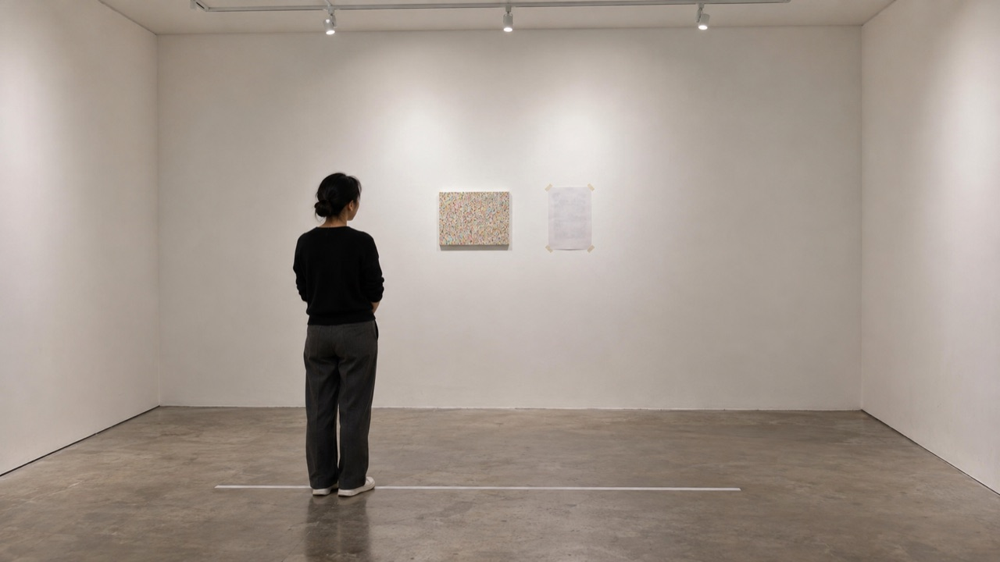

# 点描に学ぶ試し塗りと予備枠の費用

## 作品体験

- 展覧会場の入口で、床の白いテープの線に立った鑑賞者が、壁に並ぶ小さな色の点が目の中でふっと混ざり、光が増して見える瞬間に足を止める。
- 展示室の奥で、壁の隅に置かれた小さな試し塗りの色見本パネルの前に鑑賞者がしゃがみ込み、顔を近づけたり離したりしながら、点が混ざって見える距離を何度も探っている。
- 出口近くの休憩用ベンチに腰を下ろした鑑賞者が、遠くの大きな一枚を眺めながら、点が混ざる箇所と混ざりきらず揺らぐ箇所の違いを指でなぞるように見分けている。

## 主張

曖昧さを抱えたままでも、小さな試し塗りで見え方が安定した部分から順に費用を確定し、残る不確かな箇所だけを予備枠で受け止めれば、制作の費用は段階的に固められる。

## 発想の由来

- 分野: 点描(新印象派)の視覚芸術・絵画の分野
- 制作の仕組み: 鑑賞者は床の白いテープの線に立ち、壁の試し塗りキャンバスに並んだ小さな色の点が目の中で混ざり合う様子を見つめ、光の輝きと混ざり方の曖昧さを体感し、緑と赤で印した費用シートで安定箇所と予備枠の関係を理解する。

## 素材・形式

形式: Production の正本 plan に定義された形式。正本の本文と、受入済み attestation が列挙する asset を参照します。

- [concept-mockup.svg](media/concept-mockup.svg)
- [PRT002-1.svg](media/prototype/PRT002-1.svg)
- [visual-reference-board.svg](media/visual-reference-board.svg)

<!-- prototype-visualization:start -->
## 試作の可視化

約3m×4mの白い展示室の想定図です。壁に縦30cm×横40cmの試し塗りキャンバス（白ジェッソ下地の綿布張りパネル）を掛け、その右にA3の費用シートを四隅のマスキングテープで貼っています。鑑賞者は床に貼った幅2cmの白いテープの線の上に立ち、キャンバスの色の点を見ています（`plan.md` §1、§8）。費用シートの緑と赤の印は、この図には描かれていません。

Codex の画像生成で作った想定図です（2026-10-28、codex-cli 0.164.0）。生成の指示は、公開済みの `plan.md` の完成像と技術仕様（寸法・素材・組み立て・設置）から決まった手順で組み立てました（指示文 sha256 `5a64ba5d3d08`）。寸法は正確ではなく、制作した現物の写真ではありません。物理試作、外部検証、展示の実施記録を示しません。
<!-- prototype-visualization:end -->

## 制作入口

制作判断と受入条件の入口は [plan.md](plan.md) です。ここで公開されるのは検証済みの制作計画と紹介であり、物理制作、購入、契約、展示、外部連絡はこの投影から実行されません。
