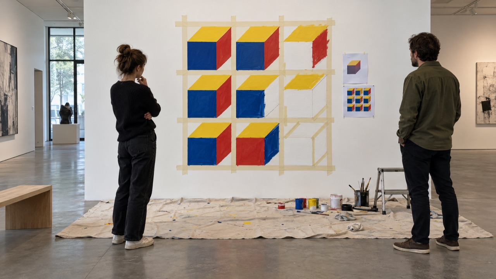

# 白木の壁、三色の指示書

## 作品体験

- 展示初日の午後、鑑賞者は壁の前に立ち、実行者が指示書を片手に3×3のgridの最初の一マスへ最初の色を置く瞬間に居合わせる。
- 会期最終日の夕方、鑑賞者は壁の前で、完成した三色のcubesを、傍らに置かれた指示書の文面と一行ずつ見比べながら確かめる。
- 会期中の平日の昼、鑑賞者は壁の横で、実行者が二色目を塗り重ねる途中に指示書のgridの記述と実際の線の位置がずれていないかを見つめる。

## 主張

白い木の壁の1m四方に、gridとcubesと3色だけで書いた指示書があれば、第三者でも構想どおりの立体図を壁に実現できる、とこの作品は主張する。

## 発想の由来

- 分野: インストラクション・ペインティング(壁画・コンセプチュアルアート)
- 制作の仕組み: 3×3のgridとcubesの立体図を3色で塗る手順だけを書いたA4一枚の指示書と作業キットを使い、実行者が白い木の壁の1m四方に塗り進める過程を、鑑賞者は壁の前で見届ける。

## 素材・形式

形式: Production の正本 plan に定義された形式。正本の本文と、受入済み attestation が列挙する asset を参照します。

- [concept-mockup.svg](media/concept-mockup.svg)
- [PRT002-1.svg](media/prototype/PRT002-1.svg)
- [visual-reference-board.svg](media/visual-reference-board.svg)

<!-- prototype-visualization:start -->
## 試作の可視化

白い木の壁を幅5cmの和紙テープで3×3のマスに区切り、赤・青・黄の3色で立方体の立体図を塗り進めている途中の想定図です。左の2列は塗り終わり、右の列は上から順に塗りかけで、右下のマスはまだ白いままです。壁の脇には A4 の指示書と確認用の紙が貼られ、床は養生されて絵具と刷毛が置かれています。鑑賞者は壁の前に立ち、指示書と塗られた形を見比べています（`plan.md` §1、§8 の TS005・TS009・TS010）。

Codex の画像生成で作った想定図です（2026-10-28、codex-cli 0.164.0）。生成の指示は、公開済みの `plan.md` の完成像と技術仕様（寸法・素材・組み立て・設置）から決まった手順で組み立てました（指示文 sha256 `b0be9cf678b8`）。寸法は正確ではなく、制作した現物の写真ではありません。物理試作、外部検証、展示の実施記録を示しません。
<!-- prototype-visualization:end -->

## 制作入口

制作判断と受入条件の入口は [plan.md](plan.md) です。ここで公開されるのは検証済みの制作計画と紹介であり、物理制作、購入、契約、展示、外部連絡はこの投影から実行されません。
