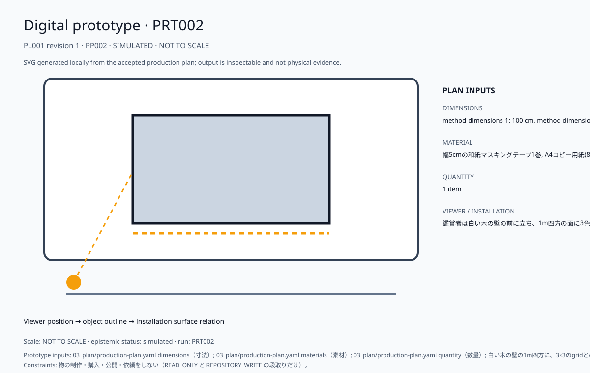

# 統合制作計画書

> この文書は、受理済みhandoffと検証済みの制作計画を、人間が読んで制作判断・制作実務に使える一つの計画書へ統合したものです。計画の生成は、購入・契約・公開・連絡・削除・物理作業の実行承認を意味しません。

### 計画メタデータ

| 項目 | 内容 |
| --- | --- |
| プロジェクト | production/auto-catalog-20261028-a-82a4cc46133a |
| 計画 | PL001 revision 1 |
| 計画状態 | PLANNING |
| 計画準備 | 開始可能 |
| 物理・外部制作 | 承認待ち |
| 開始できる最初の作業 | `TK001`, `TK004`, `TK006` |
| 後続の承認・外部確認 | PG010, PG011 |
| 出力を止める構造上の不足 | なし |
| 生成日時 | 2026-10-27T16:49:33.602030+00:00 |
| handoff | HO001 revision 1 |
| 要件カバレッジ | 100% |
| クリティカルパス | `TK001` → `TK002` → `TK003` |

## 1. 完成像

| 項目 | 内容 |
| --- | --- |
| experience sequence / encounter | 展示初日の午後、鑑賞者は壁の前に立ち、実行者が指示書を片手に3×3のgridの最初の一マスへ最初の色を置く瞬間に居合わせる。, 会期最終日の夕方、鑑賞者は壁の前で、完成した三色のcubesを、傍らに置かれた指示書の文面と一行ずつ見比べながら確かめる。, 会期中の平日の昼、鑑賞者は壁の横で、実行者が二色目を塗り重ねる途中に指示書のgridの記述と実際の線の位置がずれていないかを見つめる。 |
| position | 鑑賞者は白い木の壁の前に立ち、1m四方の面に3色でcubesが塗られていく過程を、壁面に近い距離から立ったまま見届ける。 |
| first_seconds | 白い木の壁の1m四方に、3×3のgridで区切られたcubesの立体図が、3色で塗り分けられていく様子が最初に目に入る。 |
| after_30s | 白い木の壁の1m四方に3×3のgridのcubesが3色で塗り分けられていく様子を見て、鑑賞者は指示書どおりに形が現れるかを確かめるように足を止めて見入る。 |
| after_3min | 3分後、鑑賞者の心には、gridとcubesと3色だけの指示書でここまで形が決まるのかという驚きと、自分が実行者でも同じ形になるのかという問いが残る。 |

## 2. テーマ

| 項目 | 内容 |
| --- | --- |
| field | インストラクション・ペインティング(壁画・コンセプチュアルアート) |
| stands_against | 指示書があれば作者の構想は他者によって寸分違わず再現できるという、作者の意図と実行は一致するはずだという思い込みに対抗する。 |
| difference | 先行のLeWittが"written instructions"で結果を事前に決める体系なのに対し、本案は白い木の壁1m四方のgridとcubesを3色で塗る手順だけの指示書を第三者に実行してもらう点が異なる。 |
| why_now | 2026-10-27 時点の公開資料の調査で、この案の元になった洞察（IN003）が得られた: この主張は、white wood の in situ な壁面に multicoloured な wall drawings を載せ、"written instructions" と "grid" や "cubes" の条件だけで第三者が実行できる小規模な試作を作れば検証できる可能性を示すが、どちらの主張も根拠が弱いため、耐えるかどうかは断定できない。 |

## 3. メッセージ

| 項目 | 内容 |
| --- | --- |
| claim | 白い木の壁の1m四方に、gridとcubesと3色だけで書いた指示書があれば、第三者でも構想どおりの立体図を壁に実現できる、とこの作品は主張する。 |
| who_disagrees | ソル・ルウィットの作品を実際に施工した助手のように、指示書だけでは解釈の幅が残り構想どおりにならないと考える壁画職人。 |
| denies | この作品は、指示書だけでは実行者ごとの解釈の揺れが避けられず、結果は構想どおりにならないという見方を否定する。 |
| shown_not_told | 白い木の壁の1m四方に、3×3のgridで区切られたcubesの立体図が、指示書どおりに3色で塗られて現れていく過程を見せる。 |

## 4. コンセプト

| 項目 | 内容 |
| --- | --- |
| mechanism | 3×3のgridとcubesの立体図を3色で塗る手順だけを書いたA4一枚の指示書と作業キットを使い、実行者が白い木の壁の1m四方に塗り進める過程を、鑑賞者は壁の前で見届ける。 |
| without_the_technique | CEASES_TO_WORK |
| precedents | reference=Art Gallery of New South Wales - Archive - Sol LeWitt <https://archive.artgallery.nsw.gov.au/exhibitions/archived/2010/kaldor_projects/artists/1977_sol_lewitt>, difference=先行作品は white wood pieces に呼応する multicoloured wall drawings を作る作品でしたが、採用案は白い木の壁の1m四方に grid で3×3に分け cubes の立体図を3色で塗る手順だけを指示書にし、第三者に実行してもらう点が異なります。, reference=Wall Drawing #831 (Geometric Forms) \| Guggenheim Museum Bilbao <https://pro.guggenheim-bilbao.eus/en/the-collection/works/wall-drawing-831-geometric-forms>, difference=Sol LeWitt の先行作品は "written instructions" で結果を事前に決める体系でしたが、採用案は grid と cubes を使い、3色で塗る手順だけを書いた指示書を第三者に実行してもらう点が異なります。 |
| self_repetition_risk | reference=creator history not supplied (Stage B --history-root), assessment=UNKNOWN: Creator history was not supplied; repetition is unmeasured. |

## 5. 調査の要約

| 項目 | 内容 |
| --- | --- |
| questions | "The idea becomes a machine"は、費用先行と確定待ちが同日に現れる状況で、市場の具体性にどう応えるのか？, この命題は制作に耐えるか確かめるため、費用先行と確定待ちを結ぶ具体的な作品として何を作るべきか？, 同じ日に同時に現れる費用先行と確定待ちの迷いを、「The idea becomes a machine」はどんな具体的な仕組みで制作に耐える形にするのか？, 費用先行と確定待ちが同じ日に現れるとき、「The idea becomes a machine」はどんな具体物で両者をつなげるのか？, 同じ日に費用先行と確定待ちが並ぶ迷いは、コンセプチュアル・アートの「アイデアが機械になる」考え方で、市場の具体性とどう結ばれるのか？, 同じ日に現れる費用先行と確定待ちを、参照の観点から見て、作品として試すには何を最初に作ればよいか？, 命題が制作に耐えるかを確かめるため、費用先行の迷いを仕組みとして動かす最小の作品は、どんな形になるのか？, 同じ日に並ぶ費用先行と確定待ちの両方を引く判断を、「アイデアが機械になる」はどんな作品の仕組みで具体性へ移すのか？ |
| what_was_read | 取得資料 43 件（内容が重複しない資料 40 件）から、根拠 30 件・抜き書き 37 件を取った。主な資料: 「Sol Lewitt on Conceptual Art - 1967 - SFAQ & NYAQ Publications」、「User:Emily/NOTES for Own Research & Resource 07 - XPUB wiki」、「The ABCs of Sol LeWitt's Art  – Phaidon」、「Artspace  – Phaidon」、「Sol LeWitt - ARTBOOK\|D.A.P.」。 |
| what_came_out | 主張 30 件、洞察 17 件、判断 17 件。IN001: The idea becomes a machine"は概念の成立過程に重点を置くため、市場の費用先行や確定待ちといった具体性には直接応えていない可能性が高いが、値上がりと形の目減りへの皮肉との関係は抜き書きだけでは断定できない。 IN002: この主張は資料集が図版と文章の両面を備えることを示すに留まり、市場の具体性への応答までは確定できないため、断定は避けるべきだという洞察に限られる。 IN003: この主張は、white wood の in situ な壁面に multicoloured な wall drawings を載せ、"written instructions" と "grid" や "cubes" の条件だけで第三者が実行できる小規模な試作を作れば検証できる可能性を示すが、どちらの主張も根拠が弱いため、耐えるかどうかは断定できない。 |
| what_is_not_settled | 未解決の問い 1 件（Q006）。対立したままの主張の組 3 件。調査の下限に届かない項目: self_repetition_review。試作と鑑賞者による確認は未実施（調査の不確実性 17 件が OPEN）。 |

### 採択内容と根拠

| 項目 | 内容 |
| --- | --- |
| 採択仮説 | PH002 |
| 仮説タイトル | 白木の壁、三色の指示書 |
| 仮説 | 白い木の壁の1m四方に3×3のgridでcubesの立体図を3色で塗る指示書は、第三者が構想どおりに実行できるほど結果を事前に決められる、という命題を示す。 |
| 仮説状態 | PROPOSED |
| 選択状態 | PROVISIONAL |
| 選択権限 | AGENT |
| 人間承認要否 | いいえ |
| 選択理由 | 白い木の壁の1m四方に3×3のgridでcubesの立体図を3色で塗る指示書は、第三者が構想どおりに実行できるほど結果を事前に決められる、という命題を示す。 |
| 創作指針 | 05_production/creative-direction.md |

### 制作リファレンス

コンセプト、ビジュアル、制作手法の参照先です。URLは受理済みhandoffに含まれる恒久HTTPS URLだけを掲載し、アクセスできない参照や不足カテゴリはギャップとして残します。

| 分類 | 出所ID | 種別 | 概要 | アクセスURL | 状態 | URL理由コード |
| --- | --- | --- | --- | --- | --- | --- |
| その他 | DC001 | decision | DC001-option-1 selected under IN001: The idea becomes a machine"は概念の成立過程に重点を置くため、市場の費用先行や確定待ちといった具体性には直接応えていない可能性が高いが、値上がりと形の目減りへの皮肉との関係は抜き書きだけでは断定できない。 | URL未提供（gap参照） | MISSING | INTERNAL_RECORD |
| その他 | DC003 | decision | DC003-option-1 selected under IN003: この主張は、white wood の in situ な壁面に multicoloured な wall drawings を載せ、"written instructions" と "grid" や "cubes" の条件だけで第三者が実行できる小規模な試作を作れば検証できる可能性を示すが、どちらの主張も根拠が弱いため、耐えるかどうかは断定できない。 | URL未提供（gap参照） | MISSING | INTERNAL_RECORD |
| その他 | IN001 | insight | The idea becomes a machine"は概念の成立過程に重点を置くため、市場の費用先行や確定待ちといった具体性には直接応えていない可能性が高いが、値上がりと形の目減りへの皮肉との関係は抜き書きだけでは断定できない。 | URL未提供（gap参照） | MISSING | INTERNAL_RECORD |
| その他 | IN003 | insight | この主張は、white wood の in situ な壁面に multicoloured な wall drawings を載せ、"written instructions" と "grid" や "cubes" の条件だけで第三者が実行できる小規模な試作を作れば検証できる可能性を示すが、どちらの主張も根拠が弱いため、耐えるかどうかは断定できない。 | URL未提供（gap参照） | MISSING | INTERNAL_RECORD |
| その他 | EV001 | evidence | agent-retrieved-public; rights_status=unknown; sensitivity=PUBLIC_CITABLE | <https://www.sfaq.us/2011/11/sol-lewitt-on-conceptual-art-1967/> | AVAILABLE | — |
| その他 | EV003 | evidence | agent-retrieved-public; rights_status=unknown; sensitivity=PUBLIC_CITABLE | <https://www.phaidon.com/en-eu/blogs/artspace/the-abcs-of-sol-lewitts-art> | AVAILABLE | — |
| ビジュアル | EV004 | evidence | agent-retrieved-public; rights_status=unknown; sensitivity=PUBLIC_CITABLE | <https://www.artbook.com/9783037643068.html> | AVAILABLE | — |
| その他 | EV005 | evidence | agent-retrieved-public; rights_status=unknown; sensitivity=PUBLIC_CITABLE | <https://archive.artgallery.nsw.gov.au/exhibitions/archived/2010/kaldor_projects/artists/1977_sol_lewitt> | AVAILABLE | — |
| その他 | EV006 | evidence | agent-retrieved-public; rights_status=unknown; sensitivity=PUBLIC_CITABLE | <https://pro.guggenheim-bilbao.eus/en/the-collection/works/wall-drawing-831-geometric-forms> | AVAILABLE | — |
| 手法 | EV021 | evidence | agent-retrieved-public; rights_status=unknown; sensitivity=PUBLIC_CITABLE | <https://infiniteimages.toledomuseum.org/artist/sol-lewitt> | AVAILABLE | — |
| コンセプト | EV028 | evidence | agent-retrieved-public; rights_status=unknown; sensitivity=PUBLIC_CITABLE | <https://www.proa.org/eng/exhibicion-proa-sol-lewitt--wall-drawings--textos.php> | AVAILABLE | — |

### 要件と受入の目的

| 要件 | 優先度 | 要件内容 | 出所 | 受入テスト | 計画上の対応 |
| --- | --- | --- | --- | --- | --- |
| RQ001 | mandatory | 白い木の壁の1m四方で3×3のgridのcubesが3色に塗り分けられていく様子を、鑑賞者が足を止めて見入り、3分後には指示書だけで形が決まることへの驚きと自分でも同じ形になるかという問いを抱いている。 | 未設定 | AT001 | COVERED |
| RQ002 | mandatory | 白い木の壁の1m四方に、3×3のgridでcubesの立体図が3色の水性絵具で塗り分けられ、乾いて定着した配色が指示書と照合でき、第三者が同じ結果を再現できること。 | 未設定 | AT002 | COVERED |
| RQ003 | mandatory | 鑑賞者が白い木の壁の前に立つと、1m四方の面に3×3のgridでcubesの立体図が指示書どおり3色で塗られていき、完成した絵が指示書の記述と一致することを確認できる。 | 未設定 | AT003 | COVERED |
| RQ004 | mandatory | 鑑賞者は壁の前で、A4一枚の指示書だけを頼りに実行者が白い木の壁の1m四方に3×3のgridでcubesの立体図を3色で塗り上げるのを見届け、完成した図が構想どおりだと確かめられる。 | 未設定 | AT004 | COVERED |

## 6. できている物

### ビジュアルパッケージ

boardとmockupは、受理済みhandoffから生成した閲覧用の決定論的fixtureです。外部画像素材の取得・採用、物理制作、外部検証、公開、購入、契約、Drive共有は実施していません。

| 種別 | 名称 | 状態 | 相対リンク | asset hash | 権利 | 安全 |
| --- | --- | --- | --- | --- | --- | --- |
| ビジュアルリファレンスボード | Visual reference board · 白い木の壁の1m四方に3×3のgridでcubesの立体図を3色で塗る指示書は、第三者が構想どおりに実行できるほど結果を事前に決められる、という命題を示す。 | BOARD | [03_plan/media/visual-reference-board.svg](media/visual-reference-board.svg) | sha256:2f64a83dcae3c5ae3d70d65d8deeeda044eefce763025f5fc0c16392ac3ddb6b | PROJECT_INTERNAL | CLEAR |
| コンセプト・モックアップ | Concept mockup · 白い木の壁の1m四方に3×3のgridでcubesの立体図を3色で塗る指示書は、第三者が構想どおりに実行できるほど結果を事前に決められる、という命題を示す。 | MOCKUP | [03_plan/media/concept-mockup.svg](media/concept-mockup.svg) | sha256:854a6a9e2c90bfabf6b2cdeb82de0c9e65446bd0671bbfc8e7c70ea30d7a7399 | PROJECT_INTERNAL | REVIEW_REQUIRED |

| mockup注記 | 内容 |
| --- | --- |
| 表現種別 | CONCEPTUAL |
| 寸法 | Not to scale; physical dimensions are not supplied by the accepted handoff. |
| 素材 | Material selection remains provisional and is not a purchase or fabrication instruction. |
| 配置 | 鑑賞者は白い木の壁の前に立ち、1m四方の面に3色でcubesが塗られていく過程を、壁面に近い距離から立ったまま見届ける。 |
| 検証 | PHYSICAL_EXTERNAL validation: NOT_RUN. No physical prototype, publication, purchase, contract, or Drive share was performed. |

まだ何も作っていない。この節は、制作した物が実行台帳（`05_execution/output-versions.yaml`）に記録された時点で、現物とプレビュー画像を載せる。

## 6A. 試作（デジタル、simulated）

ここに示すのは受理済みplanから生成した決定論的なデジタルpreviewです。実物、物理試作、鑑賞者検証、公開承認の証拠ではありません。

### PRT002 / PP002

| 項目 | 内容 |
| --- | --- |
| run ID | PRT002 |
| plan revision | 1 |
| 寸法 | method-dimensions-1: 100 cm, method-dimensions-2: 100 cm, method-dimensions-3: 33.3 cm |
| 素材 | 幅5cmの和紙マスキングテープ1巻, A4コピー用紙(80g/㎡)1枚 |
| 状態 | simulated / 実物ではない / NOT TO SCALE |
| 出力 | 03_plan/media/prototype/PRT002-1.svg |

## 7. 制作範囲と成果物

| 項目 | 内容 |
| --- | --- |
| スコープ状態 | PROVISIONAL |
| 必須要件ID | RQ001, RQ002, RQ003, RQ004 |
| 試作計画ID | PP001, PP002 |
| 前提 | なし |
| 除外・未許可範囲 | publish, submit, send, purchase, contract, delete |
| 権利制約 | なし |
| 安全制約 | なし |
| プライバシー制約 | なし |
| 再計画トリガー | new_evidence, material_change, rights_or_privacy_change |

| 成果物 | 種別 | 内容 | 受入テスト | 担当能力 | 納期 | 状態 |
| --- | --- | --- | --- | --- | --- | --- |
| DL001 | production-deliverable | 白木の壁、三色の指示書 | AT001, AT002, AT003, AT004 | production-agent（PHYSICAL_EXTERNAL・PUBLICATION・PURCHASE の段取りは人の承認後に実行） | MS004 | PLANNED |

## 8. 技術仕様・材料・資源

| 仕様 | 対象 | 目標 | 許容差 | 測定方法 | 出所要件 | 状態 |
| --- | --- | --- | --- | --- | --- | --- |
| TS001 | experience-RQ001 | kind=QUALITATIVE, statement=白い木の壁の1m四方で3×3のgridのcubesが3色に塗り分けられていく様子を、鑑賞者が足を止めて見入り、3分後には指示書だけで形が決まることへの驚きと自分でも同じ形になるかという問いを抱いている。 | 未設定 | viewer_session | RQ001 | PROVISIONAL |
| TS002 | material-RQ002 | kind=QUALITATIVE, statement=白い木の壁の1m四方に、3×3のgridでcubesの立体図が3色の水性絵具で塗り分けられ、乾いて定着した配色が指示書と照合でき、第三者が同じ結果を再現できること。 | 未設定 | observation | RQ002 | PROVISIONAL |
| TS003 | interaction-RQ003 | kind=QUALITATIVE, statement=鑑賞者が白い木の壁の前に立つと、1m四方の面に3×3のgridでcubesの立体図が指示書どおり3色で塗られていき、完成した絵が指示書の記述と一致することを確認できる。 | 未設定 | viewer_session | RQ003 | PROVISIONAL |
| TS004 | mechanism-RQ004 | kind=QUALITATIVE, statement=鑑賞者は壁の前で、A4一枚の指示書だけを頼りに実行者が白い木の壁の1m四方に3×3のgridでcubesの立体図を3色で塗り上げるのを見届け、完成した図が構想どおりだと確かめられる。 | 未設定 | viewer_session | RQ004 | PROVISIONAL |
| TS005 | method-dimensions-1 | kind=QUANTITY, statement=作品全体は白い木の壁の100cm×100cm、3×3のgridの各セルは約33.3cm×33.3cm、指示書と確認用写真シートはA4(210mm×297mm)、マスキングテープは幅5cmとする。, quantity=value=100, unit=cm | 未設定 | 完成した作品または試作で作品全体と主な構成要素の寸法（数値と単位）を確かめ、提案値「作品全体は白い木の壁の100cm×100cm、3×3のgridの各セルは約33.3cm×33.3cm、指示書と確認用写真シートはA4(210mm×297mm)、マスキングテープは幅5cmとする。」と一致するかを記録する。 | なし | PROVISIONAL |
| TS006 | method-dimensions-2 | kind=QUANTITY, statement=作品全体は白い木の壁の100cm×100cm、3×3のgridの各セルは約33.3cm×33.3cm、指示書と確認用写真シートはA4(210mm×297mm)、マスキングテープは幅5cmとする。, quantity=value=100, unit=cm | 未設定 | 完成した作品または試作で作品全体と主な構成要素の寸法（数値と単位）を確かめ、提案値「作品全体は白い木の壁の100cm×100cm、3×3のgridの各セルは約33.3cm×33.3cm、指示書と確認用写真シートはA4(210mm×297mm)、マスキングテープは幅5cmとする。」と一致するかを記録する。 | なし | PROVISIONAL |
| TS007 | method-dimensions-3 | kind=QUANTITY, statement=作品全体は白い木の壁の100cm×100cm、3×3のgridの各セルは約33.3cm×33.3cm、指示書と確認用写真シートはA4(210mm×297mm)、マスキングテープは幅5cmとする。, quantity=value=33.3, unit=cm | 未設定 | 完成した作品または試作で作品全体と主な構成要素の寸法（数値と単位）を確かめ、提案値「作品全体は白い木の壁の100cm×100cm、3×3のgridの各セルは約33.3cm×33.3cm、指示書と確認用写真シートはA4(210mm×297mm)、マスキングテープは幅5cmとする。」と一致するかを記録する。 | なし | PROVISIONAL |
| TS008 | method-materials | kind=QUALITATIVE, statement=白い木の壁（合板の無垢材ではなく、表面を白い水性塗装で仕上げた木製パネル）に、水性アクリル絵具3色（例：赤・青・黄、各マット仕上げ）を刷毛で塗り、A4はコピー用紙80g/㎡、マスキングテープは幅5cmの和紙テープを使う。 | 未設定 | 完成した作品または試作で主な素材（種類・厚み・仕上げなど具体名）を確かめ、提案値「白い木の壁（合板の無垢材ではなく、表面を白い水性塗装で仕上げた木製パネル）に、水性アクリル絵具3色（例：赤・青・黄、各マット仕上げ）を刷毛で塗り、A4はコピー用紙80g/㎡、マスキングテープは幅5cmの和紙テープを使う。」と一致するかを記録する。 | なし | PROVISIONAL |
| TS009 | method-assembly | kind=QUALITATIVE, statement=白い木の壁の100cm×100cmを幅5cmのマスキングテープで3×3（各約33.3cm角）に区切り、そのgrid内に水性アクリル絵具3色を刷毛で塗り、乾燥後にテープを剥がしてcubesの立体図を仕上げる。 | 未設定 | 完成した作品または試作で組み立て方（部材をどうつなぐか）を確かめ、提案値「白い木の壁の100cm×100cmを幅5cmのマスキングテープで3×3（各約33.3cm角）に区切り、そのgrid内に水性アクリル絵具3色を刷毛で塗り、乾燥後にテープを剥がしてcubesの立体図を仕上げる。」と一致するかを記録する。 | なし | PROVISIONAL |
| TS010 | method-installation | kind=QUALITATIVE, statement=屋内ギャラリーの白い木の壁の1m四方を作業面とし、幅5cmのマスキングテープで3×3（各約33.3cm角）に区切って貼り、床を養生して前に約2m幅の余白を確保する。 | 未設定 | 完成した作品または試作で設置の方法（どこに・どう固定・配置するか）を確かめ、提案値「屋内ギャラリーの白い木の壁の1m四方を作業面とし、幅5cmのマスキングテープで3×3（各約33.3cm角）に区切って貼り、床を養生して前に約2m幅の余白を確保する。」と一致するかを記録する。 | なし | PROVISIONAL |

| 材料 | 仕様 | 数量 | 権利 | 安全 | 出所試作 | 状態 |
| --- | --- | --- | --- | --- | --- | --- |
| MT001 | 幅5cmの和紙マスキングテープ1巻 — 白い木の壁（合板の無垢材ではなく、表面を白い水性塗装で仕上げた木製パネル）に、水性アクリル絵具3色（例：赤・青・黄、各マット仕上げ）を刷毛で塗り、A4はコピー用紙80g/㎡、マスキングテープは幅5cmの和紙テープを使う。 | value=1, unit=item | REVIEW_REQUIRED | REVIEW_REQUIRED | PP001, PP002 | CANDIDATE |
| MT002 | A4コピー用紙(80g/㎡)1枚 — 白い木の壁（合板の無垢材ではなく、表面を白い水性塗装で仕上げた木製パネル）に、水性アクリル絵具3色（例：赤・青・黄、各マット仕上げ）を刷毛で塗り、A4はコピー用紙80g/㎡、マスキングテープは幅5cmの和紙テープを使う。 | value=1, unit=sheet | REVIEW_REQUIRED | REVIEW_REQUIRED | PP001, PP002 | CANDIDATE |

| 資源 | 種別 | 必要能力 | 数量 | 可用性 | 関連タスク |
| --- | --- | --- | --- | --- | --- |
| RS001 | EQUIPMENT | 水性アクリル絵具用の平筆（刷毛）1本 | value=1, unit=set | REQUIRES_CONFIRMATION | TK002 |
| RS002 | EQUIPMENT | インクジェットプリンター(A4対応のカラー機) | value=1, unit=set | REQUIRES_CONFIRMATION | TK003 |

## 9. 工程と作業手順

| 作業パッケージ | 内容 | 投入物 | 制約 | 成果物 | タスク | 担当能力 | 状態 |
| --- | --- | --- | --- | --- | --- | --- | --- |
| WP001 | 指示書と3色の絵具、テープ、刷毛のキットだけを第三者に渡して白木の壁1m四方に塗ってもらい、完成後の配色と立体感を撮影した写真シートで構想と照合し、迷いや食い違いが出ないか確かめる。 | 白い木の壁の1m四方に、3×3のgridとcubesの立体図を3色で塗る手順だけを書いたA4一枚の指示書, 白い木の壁の1m四方を囲む、3色の水性絵具と幅5cmのマスキングテープ、刷毛を入れた作業キット, 白い木の壁の1m四方に、実行者が完成後の配色を記録して指示書と照合するための、3色の塗り分けを撮影したA4の確認用写真シート | なし | DL001 | TK001, TK002, TK003 | production-agent（PHYSICAL_EXTERNAL・PUBLICATION・PURCHASE の段取りは人の承認後に実行） | BLOCKED |
| WP002 | 制作プランの寸法・素材・数量を読み、構成要素の配置を SVG の図に描いて、制作要件と照らす。 | 03_plan/production-plan.yaml dimensions（寸法）, 03_plan/production-plan.yaml materials（素材）, 03_plan/production-plan.yaml quantity（数量）, 白い木の壁の1m四方に、3×3のgridとcubesの立体図を3色で塗る手順だけを書いたA4一枚の指示書, 白い木の壁の1m四方を囲む、3色の水性絵具と幅5cmのマスキングテープ、刷毛を入れた作業キット, 白い木の壁の1m四方に、実行者が完成後の配色を記録して指示書と照合するための、3色の塗り分けを撮影したA4の確認用写真シート | 物の制作・購入・公開・依頼をしない（READ_ONLY と REPOSITORY_WRITE の段取りだけ）。 | DL001 | TK004, TK005, TK006 | digital-prototype-renderer | PLANNED |

| タスク | 作業 | 前提 | 所要時間 | 必要材料 | 受入条件 | 効果種別 | 承認 | 状態 |
| --- | --- | --- | --- | --- | --- | --- | --- | --- |
| TK001 | 白い木の壁の1m四方に、3×3のgridでcubesの立体図を3色で塗る手順だけを書いたA4一枚の指示書を、まず作成する。 | なし | value=1, unit=h | WP001の投入物 | 白い木の壁の1m四方に3×3のgridで立体cubesを3色で塗る手順だけを書いたA4一枚の指示書が、完成して手元にある。 | REPOSITORY_WRITE | なし | READY |
| TK002 | 白い木の壁の1m四方に3色の水性絵具とマスキングテープ、刷毛を入れた作業キットをまとめ、指示書と一緒に第三者へ渡せる状態にする。 | TK001 | value=1, unit=h | WP001の投入物 | 1m四方の白い木の壁用に、3色の水性絵具・マスキングテープ・刷毛がそろったキットが指示書と共に一つにまとまり、第三者がそのまま受け取れる状態になっている。 | PHYSICAL_EXTERNAL | AR001 | BLOCKED |
| TK003 | 白い木の壁の1m四方に、実行者が完成後の3色の塗り分けを撮影して指示書と照合できる、A4の確認用写真シートを用意する。 | TK002 | value=1, unit=h | WP001の投入物 | 白い木の壁の1m四方に対応するA4確認用写真シートが印刷済みで、完成後の3色の塗り分けを撮影して指示書と照合できる状態になっている。 | PHYSICAL_EXTERNAL | AR001 | BLOCKED |
| TK004 | 制作プランの寸法・素材・数量を読み、描く構成要素を並べる。 | なし | value=1, unit=h | WP002の投入物 | 構成要素ごとに寸法・素材・数量が一覧になっている。 | READ_ONLY | なし | READY |
| TK005 | 構成要素の配置を SVG の図に描いて試作の出力として保存する。 | TK004 | value=1, unit=h | WP002の投入物 | SVG の図が保存され、すべての構成要素が寸法の比率どおりに描かれている。 | REPOSITORY_WRITE | なし | BACKLOG |
| TK006 | Validate derived plan coverage | なし | value=15, unit=min | WP002の投入物 | The derived plan graph and mandatory requirement coverage are valid. | READ_ONLY | なし | READY |

**実施順の読み方:** クリティカルパスは `TK001` → `TK002` → `TK003` です。開始可能な最初の作業は `TK001`, `TK004`, `TK006` です。物理・外部効果を伴う後続タスクは承認待ちであり、承認 register と外部確認が整うまで実行されません。

## 10. 試作・受入評価

| テスト | 対象要件 | 方法 | 合格条件 | 現在結果 |
| --- | --- | --- | --- | --- |
| AT001 | RQ001 | viewer_session | 白い木の壁の1m四方で3×3のcubesが3色に塗り分けられる様子の前で鑑賞者が足を止めて見入り、3分後に「指示書だけで形が決まる」驚きと「自分でも同じ形になるか」という問いを口にすれば合格。 | NOT_RUN |
| AT002 | RQ002 | observation | 白い木の壁の1m四方に3×3のcubes立体図が3色の水性絵具で塗り分けられ、乾燥後の配色が指示書と全マスで一致し、第三者がそれだけで再現できれば合格。 | NOT_RUN |
| AT003 | RQ003 | viewer_session | 白い木の壁の前に鑑賞者が立つと1m四方の面に3×3gridのcubes立体図が3色で塗られ、完成した絵の各マスの色が指示書の記述と全て一致していれば合格とする。 | NOT_RUN |
| AT004 | RQ004 | viewer_session | 白い木の壁の1m四方にA4一枚の指示書だけで実行者が3色の3×3gridのcubes立体図を塗り上げ、完成図が構想どおりだと鑑賞者が確認できれば合格。 | NOT_RUN |

| マイルストーン | 内容 | 順序 | 前提 | 状態 |
| --- | --- | --- | --- | --- |
| MS001 | Start 指示書と3色の絵具、テープ、刷毛のキットだけを第三者に渡して白木の壁1m四方に塗ってもらい、完成後の配色と立体感を撮影した写真シートで構想と照合し、迷いや食い違いが出ないか確かめる。 | 1 | なし | PLANNED |
| MS002 | Complete 指示書と3色の絵具、テープ、刷毛のキットだけを第三者に渡して白木の壁1m四方に塗ってもらい、完成後の配色と立体感を撮影した写真シートで構想と照合し、迷いや食い違いが出ないか確かめる。 | 2 | MS001 | BLOCKED |
| MS003 | Start 制作プランの寸法・素材・数量を読み、構成要素の配置を SVG の図に描いて、制作要件と照らす。 | 3 | MS002 | PLANNED |
| MS004 | Complete 制作プランの寸法・素材・数量を読み、構成要素の配置を SVG の図に描いて、制作要件と照らす。 | 4 | MS003 | PLANNED |

## 11. 日程と予算

| 日程・予算項目 | 内容 |
| --- | --- |
| 日程モード | RELATIVE |
| 日程基準線 | PROVISIONAL |
| タスク日程 | task_id=TK001, duration=value=1, unit=h, start_at=未設定, due_at=未設定, task_id=TK002, duration=value=1, unit=h, start_at=未設定, due_at=未設定, task_id=TK003, duration=value=1, unit=h, start_at=未設定, due_at=未設定, task_id=TK004, duration=value=1, unit=h, start_at=未設定, due_at=未設定, task_id=TK005, duration=value=1, unit=h, start_at=未設定, due_at=未設定, task_id=TK006, duration=value=15, unit=min, start_at=未設定, due_at=未設定 |
| 日程ギャップ | Calendar dates and availability are not supplied by the accepted handoff; the schedule remains relative. |
| 通貨 | JPY |
| 予算総額 | amount=20000, currency=JPY |
| 予備費 | amount=2000, currency=JPY |
| 承認閾値 | amount=22000, currency=JPY |
| 予算状態 | ESTIMATED |
| 予算ギャップ | Planning amounts are fixed per-band assumptions from cost-estimation.yaml v1; they are not estimates, quotes, or observed market prices. |

| 予算項目 | 区分 | 内容 | 金額 | 根拠 | 確度 | 状態 |
| --- | --- | --- | --- | --- | --- | --- |
| BI001 | prototype-plan | Estimated cost band for PP001 | amount=10000, currency=JPY | Prototype PP001, cost band LOW, assumed amount 10000 JPY; materials: 幅5cmの和紙マスキングテープ1巻 (白い木の壁（合板の無垢材ではなく、表面を白い水性塗装で仕上げた木製パネル）に、水性アクリル絵具3色（例：赤・青・黄、各マット仕上げ）を刷毛で塗り、A4はコピー用紙80g/㎡、マスキングテープは幅5cmの和紙テープを使う。; quantity 1 item); A4コピー用紙(80g/㎡)1枚 (白い木の壁（合板の無垢材ではなく、表面を白い水性塗装で仕上げた木製パネル）に、水性アクリル絵具3色（例：赤・青・黄、各マット仕上げ）を刷毛で塗り、A4はコピー用紙80g/㎡、マスキングテープは幅5cmの和紙テープを使う。; quantity 1 sheet). The band amount is a fixed per-band planning allowance; material quantity and dimensions are not reflected in the amount. cost-estimation.yaml v1; These are planning assumptions for rough estimates, not observed market prices, quotes, or supplier commitments. | LOW | ESTIMATED |
| BI002 | prototype-plan | Estimated cost band for PP002 | amount=10000, currency=JPY | Prototype PP002, cost band LOW, assumed amount 10000 JPY; materials: 幅5cmの和紙マスキングテープ1巻 (白い木の壁（合板の無垢材ではなく、表面を白い水性塗装で仕上げた木製パネル）に、水性アクリル絵具3色（例：赤・青・黄、各マット仕上げ）を刷毛で塗り、A4はコピー用紙80g/㎡、マスキングテープは幅5cmの和紙テープを使う。; quantity 1 item); A4コピー用紙(80g/㎡)1枚 (白い木の壁（合板の無垢材ではなく、表面を白い水性塗装で仕上げた木製パネル）に、水性アクリル絵具3色（例：赤・青・黄、各マット仕上げ）を刷毛で塗り、A4はコピー用紙80g/㎡、マスキングテープは幅5cmの和紙テープを使う。; quantity 1 sheet). The band amount is a fixed per-band planning allowance; material quantity and dimensions are not reflected in the amount. cost-estimation.yaml v1; These are planning assumptions for rough estimates, not observed market prices, quotes, or supplier commitments. | LOW | ESTIMATED |

## 12. リスクと未解決事項

| リスク | 内容 | 影響 | 軽減策 | 重要度 | 可能性 | 担当 | 状態 |
| --- | --- | --- | --- | --- | --- | --- | --- |
| RK001 | 白い木の壁の1m四方で、gridとcubesと3色だけの指示書を渡された第三者が、解釈の迷いなく構想どおりの配色と立体感を再現できるかは、実際に塗ってもらわないと分からない。 | 白い木の壁の1m四方で、gridとcubesと3色だけの指示書を渡された第三者が、解釈の迷いなく構想どおりの配色と立体感を再現できるかは、実際に塗ってもらわないと分からない。 | Validate the uncertainty before relying on the affected plan decision. | MAJOR | UNKNOWN | production-agent（PHYSICAL_EXTERNAL・PUBLICATION・PURCHASE の段取りは人の承認後に実行） | OPEN |
| RK002 | Handoff gap GP001 | At least one record is required in 04_decisions/self-repetition-review.yaml. | Resolve the handoff gap and regenerate the plan before relying on the affected decision. | MEDIUM | UNKNOWN | production-agent（PHYSICAL_EXTERNAL・PUBLICATION・PURCHASE の段取りは人の承認後に実行） | OPEN |
| RK003 | Handoff gap GP002 | Rights review of the cited sources is not recorded. | Resolve the handoff gap and regenerate the plan before relying on the affected decision. | MEDIUM | UNKNOWN | production-agent（PHYSICAL_EXTERNAL・PUBLICATION・PURCHASE の段取りは人の承認後に実行） | OPEN |
| RK004 | Handoff gap GP003 | Privacy review of the project is not recorded. | Resolve the handoff gap and regenerate the plan before relying on the affected decision. | MEDIUM | UNKNOWN | production-agent（PHYSICAL_EXTERNAL・PUBLICATION・PURCHASE の段取りは人の承認後に実行） | OPEN |
| RK005 | Handoff gap GP004 | A mandatory question rests on fewer independent sources than the policy asks. | Resolve the handoff gap and regenerate the plan before relying on the affected decision. | MEDIUM | UNKNOWN | production-agent（PHYSICAL_EXTERNAL・PUBLICATION・PURCHASE の段取りは人の承認後に実行） | OPEN |

| ギャップ | 内容 | ブロッキング |
| --- | --- | --- |
| GP001 | At least one record is required in 04_decisions/self-repetition-review.yaml. | いいえ |
| GP002 | Rights review of the cited sources is not recorded. | いいえ |
| GP003 | Privacy review of the project is not recorded. | いいえ |
| GP004 | A mandatory question rests on fewer independent sources than the policy asks. | いいえ |
| PG001 | Calendar dates and availability are not supplied by the accepted handoff; the schedule remains relative. | いいえ |
| PG002 | Prototype plan PP001 names its inputs but not their quantity, rights, or availability; confirm those before execution. | いいえ |
| PG003 | Prototype plan PP002 names its inputs but not their quantity, rights, or availability; confirm those before execution. | いいえ |
| PG005 | Reference DC001 has no access URL in the accepted handoff (reason code: INTERNAL_RECORD). | いいえ |
| PG004 | Reference DC003 has no access URL in the accepted handoff (reason code: INTERNAL_RECORD). | いいえ |
| PG008 | Reference IN001 has no access URL in the accepted handoff (reason code: INTERNAL_RECORD). | いいえ |
| PG006 | Reference IN003 has no access URL in the accepted handoff (reason code: INTERNAL_RECORD). | いいえ |
| PG010 | External-effect task TK002 remains blocked until the required human approval is recorded. | はい |
| PG011 | External-effect task TK003 remains blocked until the required human approval is recorded. | はい |
| PG012 | Planning amounts are fixed per-band assumptions from cost-estimation.yaml v1; they are not estimates, quotes, or observed market prices. | いいえ |

## 13. 承認・安全境界

| 承認ID | 対象行為 | 対象 | 対象hash | 権限者 | 状態 | 理由 | 関連タスク |
| --- | --- | --- | --- | --- | --- | --- | --- |
| AR001 | PHYSICAL_EXTERNAL | 03_plan/task-plan.yaml#TK002,TK003 | sha256:b16c52f29b68816e757001bf5a9ca04e99842e300c00972c693d6039eee80662 | HUMAN | REQUIRED | Physical or external-effect tasks require explicit human approval before execution. | TK002, TK003 |

この計画書は、明示的な人間承認が記録されるまで、物理作業、外部サービスへの接続、購入、契約、支払い、公開、応募、連絡、削除を許可しません。材料の権利・安全状態、会場条件、担当能力、見積、日程は制作開始前に人間が確認してください。

## 14. 人間向け実行前チェックリスト

- 採択仮説と要件の内容・優先度を確認する。
- コンセプト、ビジュアル、手法の参照URLを開き、制作時に参照可能か確認する。
- 未設定の会場、照明、日程、予算、見積、担当能力を確定する。
- 材料の権利状態と安全状態を確認し、変更時は再評価する。
- 物理・外部効果タスクの対象・範囲・hashを確認して承認する。
- 各受入テストの実施条件と証跡の保存先を決める。
- 制作中の差分・失敗・変更要求を既存の計画に上書きせず記録する。

## 15. 証跡と再現性

| 項目 | 値 |
| --- | --- |
| handoff content hash | sha256:5775975436442ebd52f1b6b2b81f4e02977808d3cf4e54da12997e1091b4f298 |
| plan integrity hash | sha256:63b3347c3fe41b37fb049c5c91b9bd11d074ebee0fb9c2dc6d7777effb41ee86 |
| source input hash | sha256:55d2445931da252d9e13de0c2c616a6ca85c6b43739a33a954e2954675428e75 |
| 生成アルゴリズム | production-plan-v1 |
| トレーサビリティID | HO001, PH002, RQ001, RQ002, RQ003, RQ004, AT001, AT002, AT003, AT004, PP001, PP002, GP001, GP002, GP003, GP004 |
| 依存グラフ | graph_id=DG001, nodes=TK001, TK002, TK003, TK004, TK005, TK006, edges=from=TK001, to=TK002, from=TK002, to=TK003, from=TK004, to=TK005, topological_order=TK001, TK004, TK006, TK002, TK005, TK003, trace_refs=HO001, PH002, RQ001, RQ002, RQ003, RQ004, AT001, AT002, AT003, AT004, PP001, PP002, GP001, GP002, GP003, GP004, DG001 |

### 受け渡し時の注意

ユーザーに渡す計画書はこの `03_plan/production-plan.md` 一つです。`production-plan.yaml`などの構造化ファイルと`agent-contexts/`は、検証・再生成・内部運用のためにGit外の制作projectへ保持されます。制作した物は §6 に、実行台帳へ記録済みのプレビュー画像だけを貼ります。完成作品の原寸データ、RAW、動画、音声、3D、大容量asset、credential、signed URLはこの計画書へ埋め込みません。

## 制作を始めるための手順

内容検証: PLAN_READY
以下は提案です。試験・購入・設営は未実施で、外部操作の承認を含みません。

媒体: physical
制作環境: {'location': '屋内のギャラリーで、白い木の壁の1m四方を作業面とし、床は養生して、鑑賞者が前に立てる約2m幅の余白と照明、水性絵具の作業用の水場を確保する。'}

- dimensions: 作品全体は白い木の壁の100cm×100cm、3×3のgridの各セルは約33.3cm×33.3cm、指示書と確認用写真シートはA4(210mm×297mm)、マスキングテープは幅5cmとする。 (PROPOSED) — 段階 D の要素 spec.dimensions への回答。作品案 PH002 の構成要素・素材・要件から提案した値で、実測ではない。
  確認: 完成した作品または試作で作品全体と主な構成要素の寸法（数値と単位）を確かめ、提案値「作品全体は白い木の壁の100cm×100cm、3×3のgridの各セルは約33.3cm×33.3cm、指示書と確認用写真シートはA4(210mm×297mm)、マスキングテープは幅5cmとする。」と一致するかを記録する。 / 担当: production-agent / 条件: この仕様を使う作業（TK001, TK002, TK003, TK004, TK005, TK006）が終わり、受け入れテスト（AT001, AT002, AT003, AT004）を行う前。
- materials: 白い木の壁（合板の無垢材ではなく、表面を白い水性塗装で仕上げた木製パネル）に、水性アクリル絵具3色（例：赤・青・黄、各マット仕上げ）を刷毛で塗り、A4はコピー用紙80g/㎡、マスキングテープは幅5cmの和紙テープを使う。 (PROPOSED) — 段階 D の要素 spec.materials への回答。作品案 PH002 の構成要素・素材・要件から提案した値で、実測ではない。
  確認: 完成した作品または試作で主な素材（種類・厚み・仕上げなど具体名）を確かめ、提案値「白い木の壁（合板の無垢材ではなく、表面を白い水性塗装で仕上げた木製パネル）に、水性アクリル絵具3色（例：赤・青・黄、各マット仕上げ）を刷毛で塗り、A4はコピー用紙80g/㎡、マスキングテープは幅5cmの和紙テープを使う。」と一致するかを記録する。 / 担当: production-agent / 条件: この仕様を使う作業（TK001, TK002, TK003, TK004, TK005, TK006）が終わり、受け入れテスト（AT001, AT002, AT003, AT004）を行う前。
- assembly: 白い木の壁の100cm×100cmを幅5cmのマスキングテープで3×3（各約33.3cm角）に区切り、そのgrid内に水性アクリル絵具3色を刷毛で塗り、乾燥後にテープを剥がしてcubesの立体図を仕上げる。 (PROPOSED) — 段階 D の要素 spec.assembly への回答。作品案 PH002 の構成要素・素材・要件から提案した値で、実測ではない。
  確認: 完成した作品または試作で組み立て方（部材をどうつなぐか）を確かめ、提案値「白い木の壁の100cm×100cmを幅5cmのマスキングテープで3×3（各約33.3cm角）に区切り、そのgrid内に水性アクリル絵具3色を刷毛で塗り、乾燥後にテープを剥がしてcubesの立体図を仕上げる。」と一致するかを記録する。 / 担当: production-agent / 条件: この仕様を使う作業（TK001, TK002, TK003, TK004, TK005, TK006）が終わり、受け入れテスト（AT001, AT002, AT003, AT004）を行う前。
- installation: 屋内ギャラリーの白い木の壁の1m四方を作業面とし、幅5cmのマスキングテープで3×3（各約33.3cm角）に区切って貼り、床を養生して前に約2m幅の余白を確保する。 (PROPOSED) — 段階 D の要素 spec.installation への回答。作品案 PH002 の構成要素・素材・要件から提案した値で、実測ではない。
  確認: 完成した作品または試作で設置の方法（どこに・どう固定・配置するか）を確かめ、提案値「屋内ギャラリーの白い木の壁の1m四方を作業面とし、幅5cmのマスキングテープで3×3（各約33.3cm角）に区切って貼り、床を養生して前に約2m幅の余白を確保する。」と一致するかを記録する。 / 担当: production-agent / 条件: この仕様を使う作業（TK001, TK002, TK003, TK004, TK005, TK006）が終わり、受け入れテスト（AT001, AT002, AT003, AT004）を行う前。

### 最初の制作作業: TK001
白い木の壁の1m四方を幅5cmのマスキングテープで3×3（各約33.3cm角）に区切り、赤・青・黄の水性アクリル絵具を刷毛で各セルに塗ってcubesの立体図にする手順だけをA4一枚にまとめた指示書を作成する。
担当: production-agent / 開始条件: 受理済みの handoff と制作プランが手元にある。
必要な材料: なし / 資源: なし
要件: RQ001, RQ002, RQ003, RQ004 / 仕様: dimensions, materials, assembly, installation
完了確認（未実施）: A4一枚の指示書を印刷して見て、1m四方・5cm幅マスキングテープでの3×3区切り（各約33.3cm角）と赤・青・黄の水性アクリルをcubes立体図に塗る手順だけが載っていれば完了。

### 制作作業: TK002
赤・青・黄の水性アクリル絵具各1本、幅5cmのマスキングテープ1巻、刷毛1本を箱に入れ、A4の指示書1枚を添えて1m四方の白い木の壁用キットとして第三者に渡せる状態にまとめる。
担当: 制作者（人。承認後に実施） / 開始条件: TK001 の完了確認が済んでいる。; この作業の承認が承認台帳に記録されている（承認前は実施しない）。
必要な材料: MT001 / 資源: RS001
要件: RQ001, RQ002, RQ003, RQ004 / 仕様: dimensions, materials, assembly, installation
完了確認（未実施）: 箱を開けて、赤・青・黄の水性アクリル絵具各1本、幅5cmのマスキングテープ1巻、刷毛1本とA4の指示書1枚がすべて入っていて、そのまま第三者に渡せる状態になっていることを目視で確認する。

### 制作作業: TK003
A4コピー用紙(80g/㎡)1枚に、1m四方を3×3に区切った枠図と完成後の赤・青・黄の配置を示す参照欄、各セルを撮影した写真の貼付欄を印刷して、確認用写真シートを1枚用意する。
担当: 制作者（人。承認後に実施） / 開始条件: TK002 の完了確認が済んでいる。; この作業の承認が承認台帳に記録されている（承認前は実施しない）。
必要な材料: MT002 / 資源: RS002
要件: RQ001, RQ002, RQ003, RQ004 / 仕様: dimensions, materials, assembly, installation
完了確認（未実施）: 印刷されたA4用紙1枚に、3×3の枠図、赤・青・黄の参照配置、各セルの写真貼付欄がすべて鮮明に載っていて、1m四方の壁の撮影写真と並べて照合できる状態であれば完了です。

### 制作作業: TK004
制作プランを読み、100cm四方の白い木の壁、幅5cmの和紙マスキングテープ、3×3の各約33.3cmのセル9個、赤・青・黄の水性アクリル絵具各1本、刷毛1本、A4(80g/㎡)の指示書と確認用写真シート各1枚を一覧にする。
担当: production-agent / 開始条件: 受理済みの handoff と制作プランが手元にある。
必要な材料: なし / 資源: なし
要件: RQ001, RQ002, RQ003, RQ004 / 仕様: dimensions, materials, assembly, installation
完了確認（未実施）: 制作プランの壁・テープ・セル9個・絵具3本・刷毛・指示書・写真シートの全項目に、寸法・素材・数量が漏れなく記された一覧があれば完了です。

### 制作作業: TK005
100cm四方の白い木の壁を1:1の比率で、幅5cmのテープ線で3×3(各約33.3cm)に区切り、赤・青・黄の塗り領域とA4(210×297mm)の指示書・写真シートをSVGに描いて保存する。
担当: production-agent / 開始条件: TK004 の完了確認が済んでいる。
必要な材料: なし / 資源: なし
要件: RQ001, RQ002, RQ003, RQ004 / 仕様: dimensions, materials, assembly, installation
完了確認（未実施）: 保存したSVGを開いて、壁100cm四方が正方形で、5cm幅のテープ線が3×3に区切り、赤・青・黄の領域とA4(210:297)の指示書・写真シートが同一縮尺で描かれていれば完了。

### 制作作業: TK006
制作プラン、SVG、確認用写真シートを読み返し、100cm四方・幅5cmテープ・3×3の33.3cmセル9個・赤青黄3色・A4二枚という必須要件がすべて計画の手順に含まれているか照合する。
担当: production-agent / 開始条件: 受理済みの handoff と制作プランが手元にある。
必要な材料: なし / 資源: なし
要件: RQ001, RQ002, RQ003, RQ004 / 仕様: dimensions, materials, assembly, installation
完了確認（未実施）: 制作プラン・SVG・写真シートを照合し、100cm四方、幅5cmテープ、33.3cmセル3×3の9個、赤青黄3色、A4二枚の全項目が計画の手順に対応していれば完了。

### 未確定事項の確認
- GP001: リサーチ担当が「白木の壁、三色の指示書」の本文と既存資料を通読して自己反復（同一表現・構成の繰り返し）を洗い出し、結果を04_decisions/self-repetition-review.yamlに最低1件のレコードとして記録する。 / 担当: research-agent / 成立条件: 04_decisions/self-repetition-review.yamlに、自己反復の確認結果を記したレビュー記録が少なくとも1件存在し、その内容が研究品質レビューとして成立している状態になれば解消とみなす。
- GP002: 研究担当が『白木の壁、三色の指示書』の引用・再利用元を全件リスト化し、各出典の著作権者とライセンス・利用条件を確認して、結果を台帳に記録し公開や物理的使用の前に承認を得る。 / 担当: research-agent / 成立条件: 全引用・再利用元の著作権者と利用条件が台帳に記録され、公開や物理的使用の前にその権利確認の承認が得られている状態になれば解消とみなす。
- GP003: 公開前に、research担当が「白木の壁、三色の指示書」で使うデータと資料を洗い出し、個人情報や非公開情報が含まれていないか確認して、その審査結果を記録する。 / 担当: research-agent / 成立条件: 公開前に、使用データと資料に個人情報や非公開情報が含まれていないことが確認され、その審査結果が記録されている。
- GP004: 研究担当が、必須の問いについて既存の出典とは独立した別の一次資料または第三者の情報源を1件以上探して読み、既存の所見と照合して、一致すれば確定、食い違えば所見を修正する。 / 担当: research-agent / 成立条件: 必須の問いについて、既存の出典から独立した出典が方針の求める数だけ読まれ、既存の所見と一致するか食い違いが修正済みであること。
- PG001: 制作担当が出演者・会場・スタッフの空き状況を確認して具体的な日付を確定し、相対スケジュールを暦日付に置き換えた版を関係者に共有する。 / 担当: production-agent / 成立条件: 出演者・会場・スタッフの空き状況が確認され、全ての予定が具体的な暦日付で確定し、関係者がその日付を確認できる状態になっていること。
- PG002: 制作担当がPP001の入力素材ごとに必要数量・権利許諾の有無・調達可能時期を権利元や在庫台帳で確認し、一覧表にまとめて実行前に承認を得る。 / 担当: production-agent / 成立条件: PP001の全入力素材について、必要数量・権利許諾・調達時期が確認済みで、その一覧が実行前に承認されている状態。
- PG003: 制作担当がPP002の入力素材を一覧化し、各素材の数量・権利者と利用許諾の有無・入手可能時期を権利元や調達先に確認して記録し、実行前に確定させる。 / 担当: production-agent / 成立条件: PP002の全入力素材について数量・権利・利用許諾・入手時期が確認済みで、実行前に確定した状態になっていること。
- PG005: 制作担当者が社内記録DC001の原本を確認し、公開可能なURLの有無を調べ、なければ内部記録として出典・保管場所を明記して引き渡し資料を更新する。 / 担当: production-agent / 成立条件: DC001の引き渡し資料に、公開URLまたは内部記録としての出典と保管場所のいずれかが明記され、第三者が参照元を特定できる状態になっていること。
- PG004: 制作担当が社内記録DC003の原本を確認し、公開可能なアクセスURLの有無を調べ、あれば引き継ぎ資料へ追記し、なければ社内参照のみと明記して判断への影響を再評価する。 / 担当: production-agent / 成立条件: DC003について、公開可能なアクセスURLが引き継ぎ資料に記載されているか、または社内参照のみであることが明記され、その上で判断への影響が再評価済みであること。
- PG008: 制作担当が社内記録IN001の保管場所を確認し、閲覧可能な社内パスまたは管理者名を引き継ぎ資料に追記して、この制作判断の根拠を検証可能にする。 / 担当: production-agent / 成立条件: 引き継ぎ資料にIN001の閲覧可能な社内パスまたは管理者名が記載され、第三者がその記録を開いて制作判断の根拠を確認できる状態になっていること。
- PG006: 制作担当が社内記録IN003の保管場所を確認し、閲覧可能な社内URLまたは保管パスを引き継ぎ資料に追記して、内容が制作判断と一致するか照合する。 / 担当: production-agent / 成立条件: 社内記録IN003の閲覧可能な社内URLまたは保管パスが引き継ぎ資料に記載され、その内容が制作判断と矛盾しないことが確認されている状態。
- PG012: 制作担当が cost-estimation.yaml v1 の各バンド固定額を、複数の業者見積もりや実勢価格と照合し、差異があれば金額を更新して根拠付きで再承認を得る。 / 担当: production-agent / 成立条件: 各バンドの固定額が実際の業者見積もりや実勢価格で裏付けられ、承認済みの根拠付き金額として確定していること。

### 再利用する知識の条件

